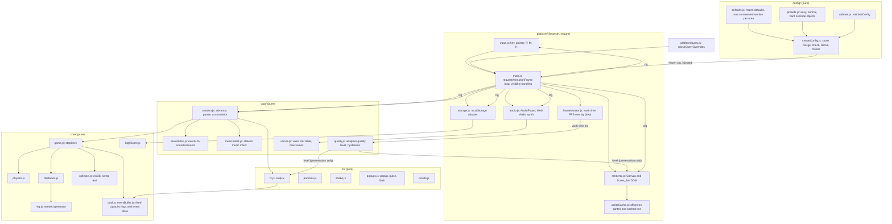
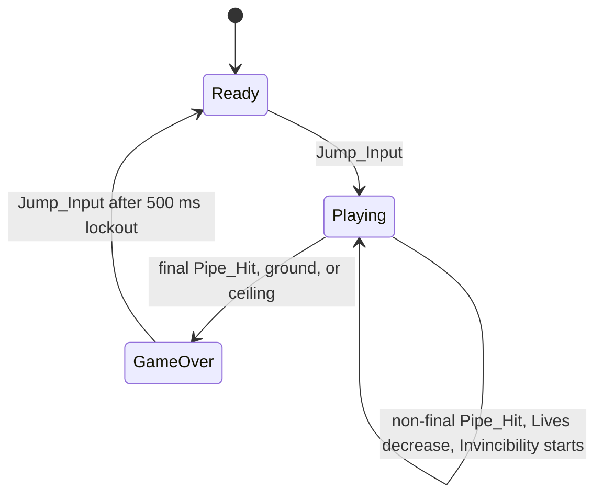
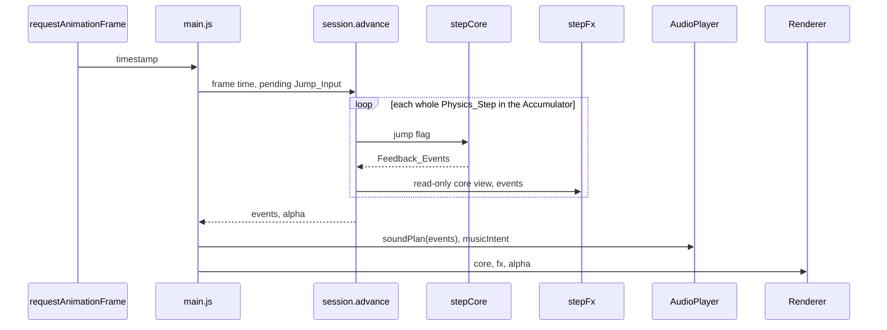

# Design Document

## Overview

Flappy Kiro is a static browser game: `index.html`, `styles.css`, plain ES modules, and the three existing assets (`assets/ghosty.png`, `assets/jump.wav`, `assets/game_over.wav`). It has no server-side component and no build step. The player guides Ghosty through pipe pairs on a 640 x 480 Canvas with a 4:3 aspect ratio. Ghosty has 3 Lives, a post-hit Invincibility window, and dies immediately on touching the ground or ceiling.

The design is driven by the following goals. Goals 1 to 3 come from the requirements. Goal 4 is a design-level extension. Goal 5 is a design-level performance guideline, because `requirements.md` has no performance requirement:

1. **Determinism and refresh-rate independence** (Requirements 13, 14, 15, 20). All gameplay advances in fixed 1/60 s Physics_Steps fed by an integer-tick Accumulator, so the same inputs and seed always produce the same Physics_State on 30 Hz to 144 Hz displays.
2. **Testable logic** (Requirements 13 to 20). Physics, obstacle generation, collision, lives, scoring, feedback state, and sound planning are pure modules with no DOM, Canvas, Web Audio, `Math.random`, or `Date` access. Only a thin `platform/` layer touches the browser.
3. **Presentation-only feedback** (Requirements 19, 20). Sound, shake, particles, popups and clouds read a read-only view of the game core and the Feedback_Events it emits. They cannot write to the core, and they draw random numbers only from a separate Effects_Random_Source.
4. **One central, injected config** (design-level extension of Requirements 13.1, 14.1, 14.10, and 20.3). Every constant and parameter lives in one frozen `config` object defined in `src/config/defaults.js`. `createConfig(overrides)` produces the object the game actually uses (merged, validated, with a computed `derived` section, deeply frozen), and `main.js` passes it down by injection. No other module defines a tunable value or imports the defaults.
5. **Smooth 60 FPS with bounded memory** (design-level guideline, see "Performance and Memory"). The target is a 16.7 ms frame. Rendering uses pre-rendered sprites and batched draws on Canvas 2D. All per-step and per-frame objects (Pipe_Pairs, Particles, Score_Popups, events, scratch rectangles) come from preallocated fixed-capacity stores, so the hot path allocates nothing. Under overload the game degrades presentation only (never the core), and its tunables live in `config.performance`.

The requirement terms Physics_Config, Difficulty_Config, Collision_Config, and Feedback_Config are kept as names for sections of that one object: Physics_Config is `config.physics`, Difficulty_Config is `config.difficulty`, Collision_Config is `config.collision`, and Feedback_Config is `config.feedback` (the synthesis details of the sounds it selects are in `config.audio`). The other sections are `config.layout`, `config.rng`, `config.input`, `config.storage`, `config.palette`, `config.performance` (frame budget, adaptive quality, pool capacities, monitor, benchmark), and the computed `config.derived`.

### Research Summary

| Topic | Finding | Design consequence |
|---|---|---|
| Fixed time step | A fixed simulation step with an accumulator, a clamp on frame time, and render-time interpolation is the standard way to get frame-rate independent, deterministic motion ([Fix Your Timestep, Gaffer On Games](https://gafferongames.com/post/fix_your_timestep/)). | Requirement 13 is implemented directly as `Accumulator`, `Max_Frame_Time`, and `alpha = accumulator / step`. |
| Floating-point accumulators | Summing floating-point frame times in different splits can give a different number of whole steps. | The Accumulator is an integer count of ticks (1 tick = 1/60000 s, one step = 1000 ticks), so Requirement 13.20 holds exactly. |
| Autoplay policy | Browsers keep an `AudioContext` suspended until a user gesture ([MDN Web Audio best practices](https://developer.mozilla.org/en-US/docs/Web/API/Web_Audio_API/Best_practices)). | The Audio_Player creates or resumes its context on the first Jump_Input or key press (Requirement 18.12) and treats failure as silence. |
| Gapless looping | Scheduling notes ahead of time on the `AudioContext` clock avoids gaps that `setTimeout` timing would cause. | Background_Music uses a look-ahead scheduler on `audioContext.currentTime`. |
| ES modules and `file://` | Browsers block module scripts loaded from `file://` because of CORS rules ([MDN JavaScript modules](https://developer.mozilla.org/en-US/docs/Web/JavaScript/Guide/Modules)). | "Static files" means any static host (for example `python -m http.server` or GitHub Pages). No game logic runs on the server. This is stated in the README. |
| Flap sound via `HTMLAudioElement` | `fetch` plus decoding fails on `file://` and adds async loading. An `Audio` element needs neither. | `jump.wav` and `game_over.wav` use `HTMLAudioElement` with `currentTime = 0` before `play()` (restart semantics, Requirement 10.1). |
| Test tooling | Node's built-in runner ([node:test](https://nodejs.org/api/test.html)) runs ES modules with no setup. [fast-check](https://fast-check.dev/) is the standard property-based testing library for JavaScript. | Tests use `node --test` and `fast-check`, with the only dev dependency being `fast-check`. |
| Query string parsing | [`URLSearchParams`](https://developer.mozilla.org/en-US/docs/Web/API/URLSearchParams) parses `location.search` in browsers and in Node, so the parser can be tested without a browser. | `parseQueryOverrides` is built on `URLSearchParams`. |
| Freezing | [`Object.freeze`](https://developer.mozilla.org/en-US/docs/Web/JavaScript/Reference/Global_Objects/Object/freeze) is shallow, so nested objects and arrays stay writable unless frozen recursively. [`structuredClone`](https://developer.mozilla.org/en-US/docs/Web/API/Window/structuredClone) copies plain data without sharing references. | `createConfig` clones the defaults, merges, and applies a recursive `deepFreeze` to the result. |
| Canvas optimization | Pre-rendering repeated drawing to an offscreen canvas, drawing with `drawImage`, avoiding state changes and blur, and opaque contexts are the standard Canvas 2D optimizations ([MDN: Optimizing canvas](https://developer.mozilla.org/en-US/docs/Web/API/Canvas_API/Tutorial/Optimizing_canvas)). The `alpha: false` context option lets the browser skip blending with the page ([MDN: getContext](https://developer.mozilla.org/en-US/docs/Web/API/HTMLCanvasElement/getContext)). | `platform/spriteCache.js` pre-renders every repeated visual once. The Canvas is opaque (the sky is filled every frame), so it is created with `alpha: false`. No `shadowBlur`, no `filter`. |
| Object pooling | A fixed pool of preallocated objects that are reused avoids allocation and garbage collection pauses in the frame loop ([Game Programming Patterns: Object Pool](https://gameprogrammingpatterns.com/object-pool.html)). | `core/pool.js` provides fixed-capacity FIFO ring buffers for Pipe_Pairs, Particles, and Score_Popups, and `core/eventBuffer.js` provides a reused event store. |
| Page visibility | Browsers pause or throttle `requestAnimationFrame` in hidden tabs, and the `visibilitychange` event reports the change ([MDN: Page Visibility API](https://developer.mozilla.org/en-US/docs/Web/API/Page_Visibility_API)). | The loop discards the elapsed time on return, so hidden time never reaches the Accumulator. |
| Audio node cost | `AudioBufferSourceNode` is a cheap, one-shot node that plays a decoded or generated `AudioBuffer`, and the buffer can be shared by many sources ([MDN: AudioBufferSourceNode](https://developer.mozilla.org/en-US/docs/Web/API/AudioBufferSourceNode)). | Procedural sounds are generated into `AudioBuffer`s once at unlock time and played with one short-lived source node per play. |

### Key Design Decisions

| Decision | Rationale |
|---|---|
| Pure `core` and `fx` modules, impure `platform` layer | Lets Node tests cover all logic without a browser. |
| `stepCore` mutates a state object in place and appends events to a caller-supplied, preallocated `EventBuffer` | Avoids per-step allocation. Earlier drafts returned a fresh event array. The event list is still the only output channel, and tests read it through `eventsToArray(buffer)`, which copies. Determinism is tested by replaying from a fresh `createGame(seed)`. |
| Integer-tick Accumulator | Makes "same total time, different frame splits" exactly equal (Requirement 13.20). |
| Spawn pipes at the right edge exactly, not at `last.x + Pipe_Spacing` | Avoids a visible pop-in. The spacing error is bounded by one step of travel (at most 3.67 px at Max_Pipe_Speed), which the spacing property checks. |
| Feedback events come only from `stepCore` | Sound counts become independent of frame rate (Requirement 18.6). |
| Pause lives in the app session, not in the core | The core only advances when the session runs steps, so a paused game holds all state with no special cases (Requirement 11). |
| `pointerdown` for mouse and touch | One handler covers both, avoiding a double Jump from emulated mouse events. |
| One config object, injected | A single place to read and tune every value. Passing it as a parameter keeps modules pure and lets tests build any variant with `createConfig`. |
| Derived values computed once in `createConfig` | Values such as tick counts and Ghost_X follow from inputs. Storing them as separate inputs would let an override make them inconsistent. |
| Dotted paths for query overrides | See "Query overrides: dotted paths or flat names" under Components and Interfaces. |
| Pipe_Pairs live in a FIFO ring of preallocated objects | All pairs move at the same speed, so they leave the screen in spawn order. A ring keeps spawn order (the leftmost pair is always the head) with no shifting, no swap-remove, and no allocation. See "Memory management and pooling". |
| Adaptive quality is presentation-only and driven by measured work time | The quality level is an input to `stepFx` and the renderer only. It never reaches `stepCore`, so Physics_State, Score, Lives, and the gap sequence cannot depend on machine speed (Requirements 19 and 20). |
| Canvas 2D with prebuilt sprites, no WebGL batcher | At fewer than about 100 draw calls per frame, Canvas 2D meets the 16.7 ms budget. A WebGL batcher would add context loss handling, shader code, and a second renderer to test for no measurable gain at this scale. |
| The step cap is an overload bound, not a pacing tool | `maxStepsPerFrame` bounds work in one frame. It defaults to the number of steps in Max_Frame_Time (15), so with defaults it never changes results. Lowering it trades simulation time for responsiveness on slow devices, and the dropped time is discarded. |

## Architecture



**Dependency rule.** `core/`, `fx/`, `app/` and `config/` import only from each other (and `core/` and `config/` never import `fx/` or `app/`). They never reference `window`, `document`, `localStorage`, `AudioContext`, `Math.random`, or `Date`. Every random number comes from an injected seeded generator. The `platform/` layer is the only code that touches the browser and holds no game rules.

**Config rule.** Only `main.js` (and tests) import `config/defaults.js`, `config/presets.js`, and `config/createConfig.js`. Every other module receives the frozen config object, or one section of it, as a function parameter (`cfg` in the signatures below). No module reads a module-level mutable value, and no module under `core/`, `fx/`, or `app/` contains a numeric literal that is a tunable parameter (enforced by the lint test in the Testing Strategy). Structural constants such as `0`, `1`, `2`, `-1`, and `0.5` (halving) and the fixed algorithm constants in `core/rng.js` are the only literals allowed there.

**Allocation rule.** Everything that runs once per Physics_Step or once per frame (`stepCore`, `stepFx`, `session.advance`, `soundRequests`, the renderer's draw functions) allocates nothing. Pair, particle, popup, event, and scratch-rectangle storage is created once in `create*` functions at startup (and at `Ready` reset, which only resets fields). Hot-path functions are top-level functions, so there are no per-frame closures, and they do not use `map`, `filter`, `slice`, `concat`, spread, template strings, or object and array literals (a lint test enforces this on a list of hot-path files, see the Testing Strategy).

### File Layout

```
index.html
styles.css
package.json                 ("type": "module", devDependency: fast-check)
assets/                      ghosty.png, jump.wav, game_over.wav (existing)
src/
  main.js
  config/    defaults.js presets.js createConfig.js validate.js
  core/      rng.js geometry.js physics.js obstacles.js collision.js game.js highScore.js
             pool.js eventBuffer.js
  fx/        fx.js particles.js shake.js popups.js clouds.js
  app/       session.js soundPlan.js musicIntent.js quality.js voices.js
  platform/  renderer.js audio.js input.js storage.js query.js
             spriteCache.js frameMonitor.js
             tuningPanel.js      (optional, dev only, see "Layer 3")
bench/       bench.js            (npm run bench, see "Performance tests and benchmark")
test/
  helpers/   pbt.js arbitraries.js testConfig.js freshStores.js readOnlyView.js
  noMagicNumbers.test.js         (lint test)
  *.test.js
```

### Game State Machine



Pause is an overlay on `Playing` held by the session. While paused no Physics_Step runs.

### Frame and Step Flow



### Physics_Step Order

`stepCore(state, cfg, jumpPressed)` runs these phases in order. The order resolves the ties that the requirements leave open.

1. **Save previous values.** Copy `ghost.y` to `ghost.prevY` and each `pipe.x` to `pipe.prevX`.
2. **Phase dispatch.**
   - `Ready`: if `jumpPressed`, start the round (set Score 0, Lives to Initial_Lives, Invincibility_Timer 0, Pipe_Speed to Initial_Pipe_Speed, spawn timer to First_Spawn_Delay, record `highAtRoundStart`), apply the Jump, emit `gameStart` and `jump`, and set the phase to `Playing`. Otherwise do nothing (no Gravity).
   - `GameOver`: run the Game_Over_Animation step (below). If `jumpPressed` and `gameOverElapsed >= layout.restartLockout` (0.5 s by default), reset to `Ready` and emit `reset`. A Jump_Input before the lockout ends is discarded.
   - `Playing`: continue with steps 3 to 9.
3. **Jump.** If `jumpPressed`, set `vy = -min(Jump_Velocity, Max_Rise_Speed)` and emit `jump`.
4. **Integrate the Ghost.** `v1 = clamp(v0 + Gravity * dt)` and `y1 = y0 + (v0 + v1) / 2 * dt`, where `v0` is the velocity after any Jump.
5. **Timers and pipes.** Decrease `invincibility` by `dt` (minimum 0). Move every pipe by `-Pipe_Speed * dt`. Count down the first-spawn delay or check the spacing trigger and spawn at most one pipe at `x = Canvas_Width` (`acquirePair` takes the next slot of the pair ring and resets every field; if the ring is full the spawn is dropped and a `poolExhausted` event is emitted, which valid configs never reach). Remove pipes with `x + Pipe_Cap_Width < 0` by releasing them from the head of the ring (`releaseOldest`). Because all pairs share one speed, the pair that leaves is always the oldest one, so releasing from the head is exact.
6. **Boundary test.** If the Ghost_Hitbox bottom is at or below the ground or its top is at or above the ceiling, clamp the Ghost into the Playfield, enter `GameOver` with cause `ground` or `ceiling`, emit `gameOver`, and stop the step. This takes precedence over any Pipe_Hit in the same step, and the Lives do not change (Requirement 15.19).
7. **Pipe test.** If `invincibility == 0`, run the Swept_Test of the Ghost_Hitbox against all four Pipe_Rectangles of every Pipe_Pair. If any overlap is found, it is one Pipe_Hit: Lives decrease by 1 (only once per step, even for several rectangles). If Lives are now 0, enter `GameOver` with cause `pipe`, emit `gameOver` (and no `hit`), and stop the step. Otherwise set `invincibility = Invincibility_Duration`, set `vy` to the Knockback (clamped), and emit `hit`. When several pairs overlap, the leftmost pair decides the Knockback direction.
8. **Scoring.** For each pair that is not yet scored with `prevX + Pipe_Cap_Width >= ghost.x` and `x + Pipe_Cap_Width < ghost.x`, mark it scored and increase the Score by 1, regardless of Invincibility. Emit `score`. Update the High_Score. If the Score first exceeds `highAtRoundStart` (which must be greater than 0), emit `newHigh`.
9. **Speed.** When the Score changed, set `Pipe_Speed = min(Max_Pipe_Speed, Initial_Pipe_Speed + Speed_Increment * floor(Score / Speed_Interval))`. Emit `speedUp` if the value increased.

Game_Over_Animation step: apply Gravity and clamp velocity, advance `y` by the same integration as step 4, clamp the Ghost_Hitbox bottom to the ground, and add `dt` to `gameOverElapsed`. The animation is "running" while `gameOverElapsed < collision.gameOverAnimationDuration` and the Ghost_Hitbox is above the ground. Pipes are not moved or spawned and no Pipe_Hit is tested.

## Components and Interfaces

All coordinates are Canvas pixels with the origin at the top-left and `y` pointing down. All durations in the logic layer are in seconds of Physics_Step time unless a name ends in `Ticks`.

### config/

All constants and parameters live in one object. `defaults.js` is the only file that holds tunable values. `createConfig.js` turns defaults plus optional overrides into the config the game uses.

#### Layer 1: single defaults file

`config/defaults.js` exports `defaults`, a deeply frozen nested object with one commented section per area. Every leaf has a comment giving its unit. The section list and the full default values are in the Data Models section. The shape is:

```js
// config/defaults.js (excerpt; the complete values are in the Data Models tables)
export const defaults = deepFreeze({
  layout: {
    canvasWidth: 640,          // px
    canvasHeight: 480,         // px
    ghostXFraction: 1 / 3,     // fraction of canvasWidth (Ghost_X is derived from it)
    ghostStartYFraction: 0.5,  // fraction of canvasHeight
    restartLockout: 0.5,       // s (Restart_Lockout)
    // ...
  },
  physics:    { stepsPerSecond: 60, ticksPerSecond: 60000, gravity: 1500 /* px/s^2 */, /* ... */ },
  difficulty: { gapHeight: 150 /* px */, cloudSpeeds: [12, 24, 40] /* px/s */, /* ... */ },
  collision:  { initialLives: 3 /* lives */, invincibilityDuration: 1.5 /* s */, /* ... */ },
  feedback:   { effectsVolume: 0.6 /* 0..1 */, screenShakeDuration: 0.3 /* s */, /* ... */ },
  audio:      { musicTempoBpm: 100 /* beats per minute */, musicNotes: [60, 64, 67, 72, 67, 64, 62, 65] /* MIDI */, /* ... */ },
  rng:        { effectsSeedMask: 0x9e3779b9 /* XOR mask for Effects_Random_Source */ },
  input:      { jumpKeys: ['Space'] /* KeyboardEvent.code */, /* ... */ },
  storage:    { highScoreKey: 'flappyKiro.highScore' },
  palette:    { sky: '#87ceeb' /* CSS color */, /* ... */ },
  performance: { targetFps: 60 /* frames/s */, maxStepsPerFrame: 15 /* steps */, degradeAboveMs: 12 /* ms of work per frame */, /* ... */ },
});
```

The `derived` section is not part of `defaults`. It exists only in the object returned by `createConfig`.

**Section mapping to requirement terms.**

| Requirement term | Section of the one object |
|---|---|
| Physics_Config | `config.physics` |
| Difficulty_Config | `config.difficulty` |
| Collision_Config | `config.collision` |
| Feedback_Config | `config.feedback` (sound synthesis details are in `config.audio`) |

#### Layer 2: overrides, presets, and query parameters

```js
// config/createConfig.js
export class ConfigError extends Error { /* .messages: string[] */ }
export function createConfig(overrides = {})   // -> deeply frozen config (inputs + derived)
export function inputsOf(cfg)                  // -> deep copy of cfg without `derived`

// config/presets.js
export const presets = deepFreeze({ easy: { /* overrides */ }, normal: {}, hard: { /* overrides */ } });
export function resolveOverrides(presetName, queryOverrides)  // preset first, then query leaves win

// config/validate.js
export function validateConfig(cfg) -> string[]   // empty when valid
export function assertValidConfig(cfg)            // throws ConfigError with all messages
```

`createConfig(overrides)` runs these steps in order:

1. **Check shape.** Walk `overrides` against the schema given by `defaults`. Each override leaf must be a path that exists in `defaults` (the `derived` section is not in `defaults`, so it cannot be overridden) and must have the same type as the default: a finite number, a boolean, a string, or an array whose elements match the default's element type. Collect one message per problem, for example `unknown config key 'physics.gravty'` or `physics.gravity must be a finite number, got "fast"`. A non-plain object where a section is expected is also an error.
2. **Clone and merge.** `structuredClone` the defaults and deep-merge the overrides into the clone. Objects merge key by key. Arrays replace the whole default array. The defaults and the `overrides` argument are never written to.
3. **Derive.** `computeDerived(merged)` fills the `derived` section. It is a total function: out-of-range inputs produce `NaN` or `Infinity` instead of throwing, so step 4 can report them.
4. **Validate.** `validateConfig(candidate)` checks input ranges first and then the cross-field rules (see "Validation of the Defaults"). If any step 1 or step 4 message exists, `createConfig` throws one `ConfigError` carrying all messages. Each validation message begins with a rule tag and names the paths and values involved, for example `[Rule 14.7] difficulty.gapHeight (100) must be >= collision.hitboxHeight (32) + difficulty.minClearance (80)`.
5. **Freeze.** `deepFreeze` the candidate (objects and arrays, recursively) and return it.

`createConfig` is a pure function of `overrides`. Calling it twice with equal overrides yields deeply equal results, and `createConfig(inputsOf(createConfig(o)))` equals `createConfig(o)`.

**Derived values.** These are computed only in `computeDerived` and live in `config.derived`:

| Path | Formula | Default |
|---|---|---|
| `derived.stepTicks` | `physics.ticksPerSecond / physics.stepsPerSecond` | 1000 |
| `derived.dt` | `1 / physics.stepsPerSecond` | 1/60 s |
| `derived.maxFrameTicks` | `round(physics.maxFrameTime * physics.ticksPerSecond)` | 15000 |
| `derived.ghostX` | `floor(layout.canvasWidth * layout.ghostXFraction)` | 213 px |
| `derived.ghostStartY` | `layout.canvasHeight * layout.ghostStartYFraction` | 240 px |
| `derived.gapCenterMin` | `layout.minPipeHeight + difficulty.gapHeight / 2` | 115 px |
| `derived.gapCenterMax` | `layout.canvasHeight - layout.minPipeHeight - difficulty.gapHeight / 2` | 365 px |
| `derived.hitboxMargin` | `{ left, right, top, bottom }` of the hitbox inside the sprite, including offsets | 8 px each |
| `derived.reducedParticleRate` | `feedback.particleEmitRate * feedback.reducedMotionParticleFactor` | 7.5 per s |
| `derived.reducedParticleCap` | `max(1, floor(feedback.particleMaxCount * feedback.reducedMotionParticleFactor))` | 15 |
| `derived.musicBeatSeconds` | `60 / audio.musicTempoBpm` | 0.6 s |
| `derived.passableOffsetBound` | `min(Rise_Reach(T), Fall_Reach(T))` with `T = difficulty.pipeSpacing / difficulty.maxPipeSpeed` | 176.4 px |
| `derived.frameBudgetMs` | `1000 / performance.targetFps` | 16.67 ms |
| `derived.budgetHeadroomMs` | `frameBudgetMs - (budgetSimMs + budgetFxMs + budgetRenderMs + budgetOtherMs)` | 7.0 ms |
| `derived.maxFrameSteps` | `floor(maxFrameTicks / stepTicks)` | 15 steps |
| `derived.maxLivePairs` | `ceil((layout.canvasWidth + collision.pipeCapWidth) / difficulty.pipeSpacing)` | 4 |
| `derived.requiredPairCapacity` | `maxLivePairs + 1` (a pair is spawned before the off-screen pair is released in the same step) | 5 |
| `derived.pairCapacity` | `performance.pairCapacity` if it is greater than 0, else `maxLivePairs + 2` | 6 |
| `derived.particleCapacity` | `performance.particleCapacity` if it is greater than 0, else `feedback.particleMaxCount` | 60 |
| `derived.requiredPopupCapacity` | `ceil(feedback.scorePopupDuration / (difficulty.pipeSpacing / difficulty.maxPipeSpeed)) + 1` | 2 |
| `derived.popupCapacity` | `performance.popupCapacity` if it is greater than 0, else `requiredPopupCapacity` | 2 |
| `derived.maxEventsPerStep` | `pairCapacity + 8` (one `score` per pair, plus the fixed event types) | 14 |
| `derived.frameEventCapacity` | `performance.maxStepsPerFrame * maxEventsPerStep` | 210 |

`validateConfig` also checks that `ticksPerSecond` is a multiple of `stepsPerSecond`, so `stepTicks` is an integer.

**Query overrides: dotted paths or flat names.** The design uses dotted paths, for example `?physics.gravity=1200&physics.jumpVelocity=380&difficulty.gapHeight=170`. The alternative is a flat-name table (`?gravity=1200`).

| Option | For | Against |
|---|---|---|
| Dotted paths | The config schema is the only source of truth, so there is no second table to keep in step. Any scalar leaf is reachable. Unknown paths are rejected by `createConfig` with no extra code. | Longer URLs. |
| Flat names | Short URLs. | A name table that must be edited with every new parameter, collisions when two sections share a leaf name (for example two durations), and a second place to validate. |

Dotted paths win because they cannot drift from the config. The short form for common cases is the preset (`?preset=hard`).

```js
// platform/query.js (pure, uses URLSearchParams, testable under Node)
export function buildQuery(overrides, presetName)          // inverse of the parser, for tests and the optional panel
export function parseQueryOverrides(search, defaults)
// -> { presetName: string|null, overrides: object, errors: string[] }
```

Parsing rules:

- Only the key `preset` and keys that start with a section name and a dot (`layout.`, `physics.`, `difficulty.`, `collision.`, `feedback.`, `audio.`, `rng.`, `input.`, `storage.`, `palette.`) are read. Any other parameter (for example tracking parameters) is ignored.
- The value is coerced by the type of the default at that path: number with `Number(value)` and a finite check, boolean from `true` or `false`, string as is. A failed coercion adds an entry to `errors`.
- A path that does not exist in the defaults is passed through as a raw string, so `createConfig` reports it as an unknown key. Array leaves cannot be set from the URL (an error is reported). Presets and `createConfig` can set them.
- If a key repeats, the last value wins.

Presets are plain override objects in `config/presets.js`. `normal` is `{}`. `easy` raises `difficulty.gapHeight`, lowers `difficulty.initialPipeSpeed` and `difficulty.maxPipeSpeed`, and raises `collision.initialLives`. `hard` does the opposite. The exact values are initial defaults chosen during design and a test checks that every preset passes `createConfig`. Resolution order: defaults, then the preset, then individual query overrides (`resolveOverrides(presetName, queryOverrides)`).

`main.js` flow:

```js
const { presetName, overrides, errors } = parseQueryOverrides(location.search, defaults);
try {
  if (errors.length) throw new ConfigError(errors);
  cfg = createConfig(resolveOverrides(presetName, overrides));   // unknown preset names are an error
} catch (e) {
  showConfigError(e.messages);   // on-page panel, nothing else starts
  return;
}
```

If the config is invalid (a parse error, an unknown key, a wrong type, an unknown preset, or a violated rule), the page shows the messages in an error panel with a link that removes the query string, and no Round starts. This is consistent with Requirements 14.10 and 20.3.

#### Layer 3 (optional, dev only, out of core scope): live tuning panel

`platform/tuningPanel.js` is a hidden panel, enabled only when the query has `dev=true` and toggled with `config.input.tuningPanelKey`. It edits an overrides object and shows `createConfig` errors inline. Changes are stored as pending and are applied only when the game next enters `Ready` (the session is given the new frozen config then), never mid-round, so a Round always runs on one config and stays deterministic. The panel offers "Copy as URL" (using `buildQuery`) and "Reset to defaults". It adds no correctness properties and the core game does not depend on it.

### core/rng.js

```js
export function createRng(seed)            // returns { next(): number in [0,1), getState(): number }
// mulberry32 over a 32-bit integer state. Same seed gives the same sequence.
```

The game owns two independent generators: `Random_Source = createRng(seed)` for Gap_Center and `Effects_Random_Source = createRng(seed ^ cfg.rng.effectsSeedMask)` for fx. The fixed mulberry32 constants inside `rng.js` are algorithm constants, not tunables, and are the one allowlisted file for numeric literals. A caller may pass any object with `next()` instead (Requirements 14.11 and 19.18).

### core/geometry.js

```js
export function overlapArea(a, b)                 // rects {x, y, w, h}; area of the intersection, 0 if none
export function overlaps(a, b)                    // overlapArea(a, b) > 0 (strict, Requirement 15.11)
export function ghostHitboxInto(cfg, y, out)      // writes x, y, w, h into the preallocated rect `out` and returns it; centered on (ghostX + Hitbox_Offset_X, y + Hitbox_Offset_Y)
export function ghostSpriteInto(cfg, y, out)      // sprite rect centered on (ghostX, y), written into `out`
export function pipeRectsInto(cfg, pair, out)     // `out` is a preallocated array of 4 rects: [topBody, topCap, bottomBody, bottomCap]
export function lerp(prev, cur, alpha)
```

### core/collision.js

```js
export function sweptOverlap(ghostFrom, ghostTo, rectFrom, rectTo, out)
// writes out.hit (boolean) and out.t (number or null) into a preallocated result object and returns it
```

Both rectangles move linearly during the step. The test works in the frame of the pipe rectangle: the relative displacement of the Ghost_Hitbox is `d = (ghostTo - ghostFrom) - (rectTo - rectFrom)` per axis. For each axis the strict overlap interval of `t` in `[0, 1]` is an open interval computed from the rectangle edges and `d` (the whole range `[0, 1]` if `d` is 0 and the axis overlaps strictly, empty if `d` is 0 and it does not). The step reports a hit when the two open intervals have a non-empty intersection, and returns the earliest `t` as a witness (the lower bound of the intersection, or the midpoint of the intersection when the bound itself only touches). This is exact for linear motion and matches the strict overlap definition.

```js
export function boundaryHit(cfg, y)               // -> 'ground' | 'ceiling' | null (inclusive comparison)
export function clampToPlayfield(cfg, y)          // y with the Ghost_Hitbox inside the Playfield
```

### core/physics.js

```js
export function integrate(cfg, vy, y, out)        // writes out.vy and out.y, one Physics_Step (Requirement 13.3, 13.7 to 13.9)
export function applyJump(cfg, vy)                // -> -min(Jump_Velocity, Max_Rise_Speed)
export function applyKnockback(cfg, hitboxCenterY, gapCenter) // -> signed velocity, clamped
export function clampVelocity(cfg, vy)            // within [-Max_Rise_Speed, Max_Fall_Speed]
```

### core/obstacles.js

```js
export function chooseGapCenter(cfg, rng, previousCenter | null)
export function acquirePair(store, cfg, rng, previousCenter, id)
// takes the next slot of the pair store, sets EVERY field (id, x: Canvas_Width, prevX: Canvas_Width, gapCenter, scored: false) and returns it, or returns null if the store is full
export function pipeSpeedForScore(cfg, score)
export function stepPipes(cfg, state, events)              // move, spawn (acquire), remove (releaseOldest); appends poolExhausted if a spawn is dropped
```

### core/pool.js and core/eventBuffer.js

```js
// core/pool.js
export function createRing(capacity, createItem, resetItem)
// -> { items: T[capacity], head, count, capacity }. Calls createItem() `capacity` times, once.
export function ringAcquire(ring)            // next slot at the tail, or null if count == capacity. The caller then sets every field.
export function ringReleaseOldest(ring)      // head++ (mod capacity), count--. No-op when empty.
export function ringDropOldestAcquire(ring) // like ringAcquire, but when full it releases the oldest first (used by Particles and Score_Popups)
export function ringAt(ring, i)              // i-th oldest item, 0 <= i < count
export function ringClear(ring)              // head = 0, count = 0 (items are kept for reuse)

// core/eventBuffer.js
export function createEventBuffer(capacity)  // preallocates `capacity` slots of one fixed shape
export function pushEvent(buf, type)         // returns the next slot with all fields reset, or null (and counts `overflow`) if full
export function clearEvents(buf)             // length = 0
export function eventsToArray(buf, from, to) // test helper: copies slots into plain objects
```

An event slot has one fixed shape, `{ type, score, pairId, direction, lives, cause, speed, pool }`, so slots are monomorphic and reuse needs no allocation. `pushEvent` resets every field of the slot it returns. The event `type` values are interned strings. A consumer must finish with an event slot before the buffer is cleared at the start of the next frame. The audio planner copies only the interned sound name into its own output array, and `eventsToArray` copies for tests.

### core/game.js

```js
export function createGame(cfg, { seed, highScore, rng?, pairStore? })  // -> GameState. Allocates every pool and scratch object once. `pairStore` lets tests inject the fresh-allocation reference store.
export function stepCore(state, cfg, jumpPressed, events)   // mutates state, appends CoreEvents to the EventBuffer `events`, returns the number appended. Allocates nothing.
export function snapshot(state)                              // deep, frozen copy (pairs as a plain array in spawn order). Allocates, so it is for tests and dev tools only, never the frame loop.
export function readOnlyView(state)                          // dev and test builds only: a cached Proxy over the live state whose writes throw. Created once per game.
```

### core/highScore.js

```js
export function encodeHighScore(n)                // String(n)
export function decodeHighScore(text)             // non-negative safe integer, else 0
export function loadHighScore(storage)            // storage may be null or throw; returns 0 on any failure
export function saveHighScore(storage, n)         // returns true on success, false on failure (never throws)
```

### fx/

```js
// fx/fx.js
export function createFx(cfg, { rng, reducedMotion })     // -> FxState. Allocates the particle, popup, and cloud stores once.
export function stepFx(fx, coreView, events, from, to, cfg, qualityLevel)
// advances all effect timers by one Physics_Step. `events` is the frame's EventBuffer and [from, to) is this step's slice.
// `qualityLevel` is the adaptive quality level (0 is full quality). It only scales effects (see "Adaptive quality").
export function resetFx(fx)                                // clears everything except Clouds (Requirement 12.8)

// fx/shake.js
export function shakeOffset(shake, cfg)                    // { x, y }, deterministic, no random numbers

// fx/particles.js
export function emit(fx, cfg, ghostState, speed)           // uses Effects_Random_Source only
export function stepParticles(list, cfg, pipeSpeed)        // age, move, remove, enforce cap
export function particleOpacity(p)                         // non-increasing in age

// fx/clouds.js
export function createClouds(cfg, rng)
export function stepClouds(clouds, cfg, phase)             // moves only in Ready and Playing
```

`stepFx` receives `coreView`, a read-only view of the live core state. `Object.freeze`d copies are no longer used, because a copy per step would allocate and a frozen pooled object could not be reused. In development builds and in tests the session passes `readOnlyView(state)`, a Proxy created once per game, so a write attempt throws. In production builds it passes the live state itself, and a lint test checks that no file under `src/fx` assigns to anything reached through `coreView`. Tests that need to compare states use `snapshot()`, which is a deep copy and is never called in the frame loop.

### app/session.js

```js
export function createSession(cfg, { seed, highScore, reducedMotion, pairStore? })
// -> { core, fx, accumulatorTicks, paused, pendingJump, muted, frameEvents, result, qualityLevel, stats }
// `frameEvents` is one EventBuffer with `derived.frameEventCapacity` slots and `result` is one reused { alpha, stepsRun } object.

export function advance(session, cfg, frameTicks)
// Clears frameEvents, applies Max_Frame_Time, adds to the Accumulator, and runs whole steps, but at most
// `performance.maxStepsPerFrame` of them. If whole steps remain after that, they are dropped (the Accumulator keeps
// only its fractional step) and `stats.droppedSteps` is increased. Returns the reused `session.result`; the events of
// the frame are in `session.frameEvents`.
// While paused it clears frameEvents, sets result.stepsRun = 0, and does not touch the Accumulator.

export function discardElapsed(session)
// Sets the Accumulator to 0 and clears the pending Jump. Called on resume from pause and when the tab becomes visible again.

export function togglePause(session)              // only when phase is Playing; on resume Accumulator is set to 0 and the caller resets its lastTime
export function requestJump(session)              // sets pendingJump unless paused
export function toTicks(cfg, seconds)             // Math.round(seconds * cfg.physics.ticksPerSecond)
```

`pendingJump` is consumed by the first Physics_Step of a frame. If a frame runs no step, the jump stays pending for the next frame. A Jump_Input while paused is ignored (Requirement 11.4). Held-key repeat events never reach `requestJump` (see `platform/input.js`).

### app/soundPlan.js

```js
export function soundRequests(events, muted, paused, out)
// `events` is the frame's EventBuffer and `out` is a preallocated { items: string[], length } list. Clears `out`, then appends
// one interned name ('flap' | 'score' | 'hit' | 'gameOver') per matching event, in event order, and returns `out`.
// `out.length` is 0 when muted or paused. Only names are copied, so no reference to an event slot outlives the frame.
```

Mapping: `jump` to `flap`, `score` to `score`, `hit` to `hit`, `gameOver` to `gameOver`. Because the core emits `hit` only for non-final Pipe_Hits, a final Pipe_Hit produces only `gameOver` (Requirement 18.5).

### app/musicIntent.js

```js
export function musicIntent(prev, next)
// prev and next: { phase, paused, muted }
// -> 'start' | 'pause' | 'resume' | 'fadeOut' | 'none', plus audible: boolean
```

`start` on entering `Playing`, `pause` and `resume` on pause toggles, `fadeOut` on entering `GameOver`, and `audible` is true only while `phase == 'Playing'`, not paused, and not muted. Mute is applied as gain 0 (the scheduler keeps running) so that unmuting restores audible music.

### platform/ (impure)

| Module | Responsibility |
|---|---|
| `input.js` | Receives `cfg.input`. `keydown` for any code in `input.jumpKeys` (default Space; ignore when `event.repeat`, call `preventDefault`), `pointerdown` on the Canvas (mouse and touch, `touch-action: none`), and the keys `input.pauseKey`, `input.muteKey`, `input.debugKey`. Calls the session functions. Any first key press or pointer press also tells the AudioPlayer to create or resume the Audio_Context. |
| `renderer.js` | Receives the whole config, the SpriteCache, and the quality level. Draws prebuilt sprites with `drawImage`, batched by state (see "Rendering efficiency"), with sizes from `layout`, `collision`, and `derived` and colors from `palette`, owns the Ghost image and its fallback, updates the Score_Bar DOM node, scaling to the HiDPI backing store. Writes CSS custom properties (`--canvas-width`, `--score-bar-bg`, `--score-bar-fg`, `--score-bar-font-ratio`) from the config at startup, so `styles.css` holds no tunable values. |
| `audio.js` | Receives `cfg.feedback` and `cfg.audio`. `AudioPlayer`: `unlock()`, `play(name)`, `setMuted(bool)`, `applyMusicIntent(intent)`. Procedural sounds and the music scheduler take frequencies, durations, waveforms, tempo, notes, and look-ahead from `cfg.audio`, and volumes from `cfg.feedback`. Every Web Audio call is wrapped in `try/catch`. Procedural sounds are pre-rendered `AudioBuffer`s, voices are capped by `app/voices.js`, and flap and game-over use a small `HTMLAudioElement` pool (see "Audio performance"). |
| `storage.js` | Wraps `window.localStorage` access in a function that returns `null` if access throws, then hands that and `cfg.storage.highScoreKey` to `loadHighScore` and `saveHighScore`. |
| `query.js` | `parseQueryOverrides` and `buildQuery` (see the config section). Pure apart from reading the string it is given. |
| `spriteCache.js` | Builds every offscreen sprite and cached text once at startup and again on a resize or pixel-ratio change (see "Rendering efficiency"). Never runs inside the frame loop. |
| `frameMonitor.js` | Measures work time and frame interval with `performance.now`, keeps the rolling statistics, and draws the dev-only overlay (see "Frame monitor"). |
| `main.js` | The only module that imports the config files. Parses the query, resolves the preset, calls `createConfig`, shows the error panel on failure or creates the session and injects the config into the session, renderer, audio, input, and storage. Runs `requestAnimationFrame` (the only timer), writes the High_Score on `gameOver` events, reads `prefers-reduced-motion`, measures work time and feeds the quality controller, and handles `visibilitychange` (see "Frame loop, overload, and visibility"). |

### Rendering Details

Draw order each frame (Requirements 9, 12.7, 19.5, 19.15):

1. Sky fill (`palette.sky`) and a light hand-sketched texture (`palette.skyTexture`).
2. `ctx.save(); ctx.translate(shake.x, shake.y)` (world contents start here).
3. Clouds, then pipes (interpolated `x`), then Particles, then the Ghost, then Score_Popups, then Debug_Overlay when on.
4. `ctx.restore()`.
5. Unshaken layers: heart icons at the top-left, "Ready" prompt, "Paused", "Game Over" with the final Score and "New High!" when applicable, and the Speed_Up_Flash.

Every size, offset, and color below comes from the injected config (`layout`, `collision`, `feedback`, `palette`, `derived`). The renderer holds no tunable literal.

The Ghost is drawn at `lerp(prevY, y, alpha)` with tilt `clamp(vy / physics.maxFallSpeed, -1, 1) * layout.ghostTiltMax` radians (nose up when rising). During the Game_Over_Animation the rotation is `2 * PI * feedback.gameOverSpinTurns * gameOverElapsed / collision.gameOverAnimationDuration` (two turns by default). During the hit flash the sprite is drawn in `palette.hitFlash`. During Invincibility the sprite is hidden when `floor((Invincibility_Duration - timer) / Blink_Interval)` is even, so the blink starts hidden and ends visible. The sprite is clamped so it never extends past the ceiling or ground (Requirement 15.18). If `ghosty.png` fails to load, a rounded rectangle of Ghost_Sprite_Width by Ghost_Sprite_Height in `palette.ghostFallback` is drawn.

The Score_Bar is a DOM element below the Canvas with a dark slate background (`palette.scoreBarBackground`) and bold centered text in `palette.scoreBarText`, `Score: N | High: N`. Score_Pulse is a CSS `transform: scale()` set from the fx pulse value. The New_High_Indicator toggles a class on a `<span>` that wraps "High: N". The Canvas and Score_Bar sit in one container whose width is `min(100vw, var(--canvas-width))` with `aspect-ratio` kept by the Canvas (`width: 100%; height: auto`), and the Score_Bar font size is `layout.scoreBarFontRatio` of the container width, so both scale proportionally (Requirement 9.5). The CSS custom properties are set from the config by `renderer.js`, so the stylesheet contains no tunable values. Heart icons use `layout.hud.heartSize`, `layout.hud.heartGap`, and `layout.hud.heartMargin`, filled with `palette.heart`. Hitboxes use Canvas pixel coordinates, so display scaling does not change them (Requirement 9.6).

## Data Models

### The Central Config Object

The tables below are the defaults of the single `config` object defined in `src/config/defaults.js`. The Path column gives the property path of each value. All values are initial, tunable defaults chosen during design. A developer changes them only in `defaults.js` (or at run time through `createConfig` overrides, presets, or query parameters). Where a unit appears in the Name or Default column it applies to the whole row. The prose elsewhere in this document uses the glossary names (for example Gravity); each glossary name maps to the path shown here.

#### `config.layout`

| Name | Path | Default | Notes |
|---|---|---|---|
| Canvas_Width | `layout.canvasWidth` | 640 px | 4:3 with the height below |
| Canvas_Height | `layout.canvasHeight` | 480 px | The ground is the bottom edge, y = 480 |
| Ghost_X (input) | `layout.ghostXFraction` | 1/3 | Fraction of Canvas_Width. Ghost_X itself is `derived.ghostX` = 213 px (Requirement 1.3) |
| Ghost_Start_Y (input) | `layout.ghostStartYFraction` | 0.5 | Vertically centered. Derived value: `derived.ghostStartY` = 240 px |
| Min_Pipe_Height | `layout.minPipeHeight` | 40 px | From the glossary |
| Restart_Lockout | `layout.restartLockout` | 0.5 s | Requirement 8 |
| Ghost tilt limit | `layout.ghostTiltMax` | 0.5 rad | Tilt at full rise or fall speed |
| Heart size, gap, margin | `layout.hud.heartSize`, `layout.hud.heartGap`, `layout.hud.heartMargin` | 20, 6, 10 px | Lives display at the top-left |
| Score_Bar font size | `layout.scoreBarFontRatio` | 0.05 | Fraction of container width |

#### `config.physics` (Physics_Config)

| Name | Path | Default | Notes |
|---|---|---|---|
| Physics_Step rate | `physics.stepsPerSecond` | 60 steps/s | Step duration is `derived.dt` = 1/60 s (Requirement 13.2) |
| Tick_Rate | `physics.ticksPerSecond` | 60000 ticks/s | Accumulator unit. `derived.stepTicks` = 1000 |
| Max_Frame_Time | `physics.maxFrameTime` | 0.25 s | `derived.maxFrameTicks` = 15000 (Requirement 13.2) |
| Gravity | `physics.gravity` | 1500 px/s^2 | Downward |
| Jump_Velocity | `physics.jumpVelocity` | 420 px/s | Upward. One Jump rises `420^2 / (2 * 1500) = 58.8 px` in `420 / 1500 = 0.28 s`. |
| Max_Rise_Speed | `physics.maxRiseSpeed` | 420 px/s | Equal to Jump_Velocity, so a Jump is never clamped |
| Max_Fall_Speed | `physics.maxFallSpeed` | 600 px/s | Reached after 0.4 s of free fall |

#### `config.difficulty` (Difficulty_Config)

| Name | Path | Default | Notes |
|---|---|---|---|
| Gap_Height | `difficulty.gapHeight` | 150 px | |
| Min_Clearance | `difficulty.minClearance` | 80 px | |
| Max_Gap_Offset | `difficulty.maxGapOffset` | 120 px | |
| Pipe_Spacing | `difficulty.pipeSpacing` | 220 px | |
| First_Spawn_Delay | `difficulty.firstSpawnDelay` | 1.2 s | |
| Initial_Pipe_Speed | `difficulty.initialPipeSpeed` | 140 px/s | |
| Speed_Increment | `difficulty.speedIncrement` | 10 px/s | |
| Speed_Interval | `difficulty.speedInterval` | 5 points | |
| Max_Pipe_Speed | `difficulty.maxPipeSpeed` | 220 px/s | Reached at Score 40 (`140 + 10 * 8`) |
| Cloud speeds | `difficulty.cloudSpeeds` | `[12, 24, 40]` px/s | Three distinct speeds, all below Initial_Pipe_Speed |
| Cloud widths | `difficulty.cloudWidths` | `[70, 110, 160]` px | Same length as `cloudSpeeds`, element `i` belongs to speed `i`. Slower clouds are smaller (Requirement 12.3) |
| Cloud height ratio | `difficulty.cloudAspect` | 0.5 | Height as a fraction of width |
| Cloud vertical range | `difficulty.cloudYMin`, `difficulty.cloudYMax` | 20, 200 px | Range for a Cloud's top edge |

#### `config.collision` (Collision_Config)

| Name | Path | Default | Notes |
|---|---|---|---|
| Ghost_Sprite_Width, Ghost_Sprite_Height | `collision.ghostSpriteWidth`, `collision.ghostSpriteHeight` | 48 px, 48 px | |
| Hitbox_Width, Hitbox_Height | `collision.hitboxWidth`, `collision.hitboxHeight` | 32 px, 32 px | Margin of 8 px on every side of the sprite (`derived.hitboxMargin`) |
| Hitbox_Offset_X, Hitbox_Offset_Y | `collision.hitboxOffsetX`, `collision.hitboxOffsetY` | 0 px, 0 px | |
| Pipe_Body_Width | `collision.pipeBodyWidth` | 60 px | |
| Pipe_Cap_Width | `collision.pipeCapWidth` | 72 px | Wider than the body, centered, 6 px overhang per side |
| Pipe_Cap_Height | `collision.pipeCapHeight` | 24 px | |
| Initial_Lives | `collision.initialLives` | 3 lives | |
| Invincibility_Duration | `collision.invincibilityDuration` | 1.5 s | |
| Blink_Interval | `collision.blinkInterval` | 0.1 s | |
| Knockback_Velocity | `collision.knockbackVelocity` | 300 px/s | |
| Hit_Flash_Duration | `collision.hitFlashDuration` | 0.15 s | |
| Game_Over_Animation_Duration | `collision.gameOverAnimationDuration` | 1.0 s | |

#### `config.feedback` (Feedback_Config)

| Name | Path | Default | Notes |
|---|---|---|---|
| Effects_Volume | `feedback.effectsVolume` | 0.6 (0 to 1) | |
| Music_Volume | `feedback.musicVolume` | 0.25 (0 to 1) | Lower than Effects_Volume |
| Music_Fade_Out_Duration | `feedback.musicFadeOutDuration` | 0.6 s | |
| Sound sources | `feedback.soundSources.flap`, `.gameOver`, `.score`, `.hit`, `.music` | flap: `assets/jump.wav`, gameOver: `assets/game_over.wav`, score, hit, music: `procedural` | Requirement 18.9. A value is either `procedural` or an asset path |
| Screen_Shake_Enabled | `feedback.screenShakeEnabled` | true | |
| Screen_Shake_Duration | `feedback.screenShakeDuration` | 0.3 s | |
| Screen_Shake_Magnitude | `feedback.screenShakeMagnitude` | 6 px | |
| Shake phase rate, step | `feedback.screenShakePhaseRate`, `feedback.screenShakePhaseStep` | 40 rad/s, 2.399963 rad | Direction of the deterministic shake offset (see Fx State) |
| Particle_Emit_Rate | `feedback.particleEmitRate` | 30 per second | |
| Particle_Flap_Burst_Count | `feedback.particleFlapBurstCount` | 5 | |
| Particle_Lifetime | `feedback.particleLifetime` | 0.5 s | |
| Particle_Size | `feedback.particleSize` | 3 px radius | |
| Particle_Drift | `feedback.particleDrift` | 20 px/s | Each Particle gets a random drift vector with each component in `[-20, 20]` |
| Particle vertical jitter | `feedback.particleJitterY` | 6 px | Random offset at emission |
| Particle_Max_Count | `feedback.particleMaxCount` | 60 | |
| Particle_Scroll_Factor | `feedback.particleScrollFactor` | 0.8 | Particles also move left at `Pipe_Speed * 0.8` |
| Particle_Initial_Opacity | `feedback.particleInitialOpacity` | 0.7 | |
| Reduced_Motion_Particle_Factor | `feedback.reducedMotionParticleFactor` | 0.25 | `derived.reducedParticleRate` = 7.5 per second, `derived.reducedParticleCap` = `max(1, floor(60 * 0.25)) = 15` |
| Score_Popup_Duration | `feedback.scorePopupDuration` | 0.7 s | |
| Score_Popup_Rise_Speed | `feedback.scorePopupRiseSpeed` | 40 px/s | |
| Score_Pulse_Duration | `feedback.scorePulseDuration` | 0.2 s | |
| Score_Pulse peak scale | `feedback.scorePulsePeakScale` | 1.25 | |
| Speed_Flash_Duration | `feedback.speedFlashDuration` | 1.0 s | |
| Game over spin | `feedback.gameOverSpinTurns` | 2 turns | Rotation during the Game_Over_Animation |

#### `config.audio`

These values shape the procedural sounds and the music. They are initial choices made during design.

| Name | Path | Default | Notes |
|---|---|---|---|
| Score sound | `audio.scoreFreqStart`, `audio.scoreFreqEnd`, `audio.scoreDuration`, `audio.scoreWave` | 660 Hz, 880 Hz, 0.12 s, `square` | Rising blip |
| Hit sound | `audio.hitFreq`, `audio.hitDuration`, `audio.hitWave` | 140 Hz, 0.2 s, `sawtooth` | Low thud |
| Music tempo | `audio.musicTempoBpm` | 100 beats/min | `derived.musicBeatSeconds` = 0.6 s |
| Music notes | `audio.musicNotes` | `[60, 64, 67, 72, 67, 64, 62, 65]` MIDI | One note per beat, looped |
| Music wave | `audio.musicWave` | `triangle` | Oscillator type |
| Music look-ahead, scheduler interval | `audio.musicLookAhead`, `audio.musicSchedulerInterval` | 0.25 s, 0.1 s | Scheduling on the `AudioContext` clock. The scheduler wakes 10 times per second and schedules at most one note per wake-up, which is cheap. The look-ahead is at least twice the interval, so a late timer wake-up does not cause a gap. |
| Max simultaneous voices | `audio.maxVoices` | 8 | Procedural sound voices plus music voices. When full, the oldest sound voice is stopped (see "Audio performance") |
| HTMLAudioElement pool size | `audio.elementPoolSize` | 1 | 1 keeps the restart semantics of Requirement 10.1. A larger value plays overlapping flaps round-robin |
| Pitch reference | `audio.a4Frequency` | 440 Hz | MIDI note 69 |

#### `config.rng`, `config.input`, `config.storage`, `config.palette`

| Name | Path | Default | Notes |
|---|---|---|---|
| Effects seed mask | `rng.effectsSeedMask` | `0x9e3779b9` | XOR with the seed for Effects_Random_Source |
| Jump keys | `input.jumpKeys` | `['Space']` | `KeyboardEvent.code` values |
| Pause, mute, debug keys | `input.pauseKey`, `input.muteKey`, `input.debugKey` | `KeyP`, `KeyM`, `KeyH` | |
| Tuning panel key (optional layer 3) | `input.tuningPanelKey` | `Backquote` | Used only when `dev=true` |
| Frame monitor key | `input.fpsKey` | `KeyF` | Toggles the dev-only frame monitor overlay. Used only when `dev=true`, and the overlay starts hidden |
| High_Score key | `storage.highScoreKey` | `flappyKiro.highScore` | |
| Sky, sky texture | `palette.sky`, `palette.skyTexture` | `#87ceeb`, `#9fd8ef` | CSS colors |
| Cloud, pipe body, pipe cap, pipe outline | `palette.cloud`, `palette.pipeBody`, `palette.pipeCap`, `palette.pipeOutline` | `#ffffff`, `#5fb36b`, `#4a9a58`, `#2f3b4c` | |
| Ghost fallback, hit flash | `palette.ghostFallback`, `palette.hitFlash` | `#ffffff`, `#ffffff` | |
| Heart, particle, popup text | `palette.heart`, `palette.particle`, `palette.popupText` | `#e5484d`, `#ffffff`, `#ffffff` | |
| Speed flash, new High indicator | `palette.speedFlash`, `palette.newHigh` | `#ffd24a`, `#ffd24a` | |
| Score_Bar colors | `palette.scoreBarBackground`, `palette.scoreBarText` | `#2f3b4c`, `#ffffff` | Dark slate, bold white text |

#### `config.derived`

Computed by `createConfig` only (see the table in Components and Interfaces). It is not part of the defaults and cannot be overridden.

### Validation of the Defaults

`validateConfig` evaluates each rule below on the candidate config (inputs plus `derived`), and `createConfig` runs it on every override. Each rule has a tag of the form `[Rule <requirement number>]` that appears at the start of its error message. The glossary names below map to config paths as shown in the Data Models tables. Beyond the rules listed, it checks that each input has a finite value in its valid range (for example durations greater than 0), that `cloudSpeeds` and `cloudWidths` have the same length, that `physics.ticksPerSecond` is a multiple of `physics.stepsPerSecond`, that each `feedback.soundSources` entry is `procedural` or a non-empty path, and that each `palette` entry is a CSS hex color, and the `[Perf n]` rules listed under "Performance configuration" in the Performance and Memory section. The right-hand column shows the result for the defaults.

**Requirement 14.3 (speed constants)**

| Rule | Check | Result |
|---|---|---|
| `Initial_Pipe_Speed > 0` | 140 > 0 | Pass |
| `Max_Pipe_Speed >= Initial_Pipe_Speed` | 220 >= 140 | Pass |
| `Speed_Increment >= 0` | 10 >= 0 | Pass |
| `Speed_Interval` integer and `>= 1` | 5 | Pass |

**Requirement 14.7 (gap size)**

`Gap_Height >= Hitbox_Height + Min_Clearance`: `150 >= 32 + 80 = 112`. Pass, with 38 px to spare.

**Requirement 14.9 (passability bound on Max_Gap_Offset)**

The bound uses `T = Pipe_Spacing / Max_Pipe_Speed = 220 / 220 = 1.0 s`, which is the time the Ghost has to move between the Gaps of two consecutive Pipe_Pairs at the fastest speed. The design defines the two reach values conservatively:

- `Rise_Reach(T)`: the Ghost presses Jump at the top of each previous Jump, so each cycle lasts `T_apex = v_j / Gravity` and gains `h = v_j^2 / (2 * Gravity)`, with `v_j = min(Jump_Velocity, Max_Rise_Speed)`. Only whole cycles count: `Rise_Reach(T) = floor(T / T_apex) * h`. Here `v_j = 420`, `T_apex = 0.28 s`, `h = 58.8 px`, `floor(1.0 / 0.28) = 3`, so `Rise_Reach = 3 * 58.8 = 176.4 px`.
- `Fall_Reach(T)`: free fall from rest with the Max_Fall_Speed clamp. The clamp is reached at `t_c = 600 / 1500 = 0.4 s` after `0.5 * 1500 * 0.4^2 = 120 px`, so for `T >= t_c` the distance is `120 + 600 * (1.0 - 0.4) = 480 px`.

Rule: `Max_Gap_Offset <= min(Rise_Reach(T), Fall_Reach(T)) = min(176.4, 480) = 176.4`. With `Max_Gap_Offset = 120`, the check passes with a margin of 56.4 px. The rise reach is the limiting side, and it uses only about 3.5 taps per second, which a player can sustain.

**Requirement 14.10 and 14.12 (a valid Gap_Center range exists)**

Lower bound `Min_Pipe_Height + Gap_Height / 2 = 40 + 75 = 115`. Upper bound `Canvas_Height - Min_Pipe_Height - Gap_Height / 2 = 480 - 40 - 75 = 365`. The range `[115, 365]` is non-empty (250 px wide). After restricting to within `Max_Gap_Offset` of the previous center `c` in `[115, 365]`, the range `[max(115, c - 120), min(365, c + 120)]` always contains `c`, so it is never empty. The validator also rejects configs where `lower > upper`.

**Requirement 15.2 and 15.3 (collision geometry)**

| Rule | Check | Result |
|---|---|---|
| `Hitbox_Width < Ghost_Sprite_Width` | 32 < 48 | Pass |
| `Hitbox_Height < Ghost_Sprite_Height` | 32 < 48 | Pass |
| Hitbox strictly inside the sprite on each side | margins left/right/top/bottom = `(48 - 32) / 2 = 8` with offsets 0, all greater than 0 | Pass |
| `Pipe_Cap_Width > Pipe_Body_Width` | 72 > 60 | Pass |
| `Pipe_Cap_Height > 0` | 24 > 0 | Pass |

**Requirement 16.1 and 16.9**

`Initial_Lives = 3`, an integer of at least 2. `Invincibility_Duration = 1.5 > 0`. `Blink_Interval = 0.1`, which is greater than 0 and at most 1.5. Pass.

**Requirement 17.1**

`Hit_Flash_Duration = 0.15 <= Invincibility_Duration = 1.5`. `Knockback_Velocity = 300 <= Max_Rise_Speed = 420` and `<= Max_Fall_Speed = 600`. Pass.

**Requirement 14.22 and 12.2**

Cloud speeds 12, 24, 40 are three distinct values, all below `Initial_Pipe_Speed = 140`. Pass.

**Requirement 20.3 (Feedback_Config)**

Volumes 0.6 and 0.25 are in `[0, 1]` and `Music_Volume < Effects_Volume`. All durations and magnitudes are greater than 0. `Particle_Max_Count = 60 >= 1`. Pass.

**Design check (not a numbered requirement)**

The Knockback is meant to clear the Ghost from the pipe before the Invincibility ends (Requirement 16.17). A pipe cap of width 72 passes a hitbox of width 32 in `(72 + 32) / Max_Pipe_Speed = 104 / 220 = 0.47 s` in the worst case, which is below `Invincibility_Duration = 1.5 s`.

### Core State

```js
/** @typedef {'Ready'|'Playing'|'GameOver'} Phase */

// Pair objects are created once by createGame and then reused. All five fields are always present, in this order,
// so every Pair has the same shape. acquirePair sets all five fields, never a subset.

/** @typedef {Object} Pair
 *  @property {number} id            // increasing integer
 *  @property {number} x             // left edge of the cap rectangle
 *  @property {number} prevX         // Previous_Pipe_Position
 *  @property {number} gapCenter
 *  @property {boolean} scored
 */

/** @typedef {Object} GameState
 *  @property {Phase} phase
 *  @property {{ x:number, y:number, prevY:number, vy:number }} ghost
 *  @property {{items:Pair[], head:number, count:number, capacity:number}} pipes  // FIFO ring (pairStore), oldest (leftmost) at head, capacity = derived.pairCapacity
 *  @property {number} score
 *  @property {number} highScore          // in memory, written to Storage by the app on gameOver
 *  @property {number} highAtRoundStart
 *  @property {boolean} newHigh           // New_High_Indicator for this Round
 *  @property {number} lives
 *  @property {number} invincibility      // Invincibility_Timer in seconds
 *  @property {number} pipeSpeed
 *  @property {number} spawnDelay         // seconds left until the first Pipe_Pair, then unused
 *  @property {number|null} lastCenter    // Gap_Center of the previously spawned pair
 *  @property {number} nextPairId
 *  @property {number} gameOverElapsed    // seconds since entering GameOver
 *  @property {'pipe'|'ground'|'ceiling'|null} gameOverCause
 *  @property {{ next():number }} rng     // Random_Source, used only for Gap_Center
 *  @property {{ poolExhausted:number }} stats   // dev counters; never read by game rules
 *  @property {Object} scratch            // preallocated rects and result objects reused by every step:
 *                                        // ghostRect, ghostFromRect, ghostToRect, pipeRects[4] (from), pipeRectsTo[4], swept {hit,t}, integ {vy,y}
 */
```

### Core Events

```js
/** @typedef {{type:'gameStart'}|{type:'jump'}|{type:'score', score:number}
 *   |{type:'hit', pairId:number, direction:'up'|'down', lives:number}
 *   |{type:'gameOver', cause:'pipe'|'ground'|'ceiling'}
 *   |{type:'speedUp', speed:number}|{type:'newHigh'}|{type:'reset'}
 *   |{type:'poolExhausted', pool:'pairs'}} CoreEvent */
// Logical shapes. In storage every event is one fixed-shape slot { type, score, pairId, direction, lives, cause, speed, pool }
// in the EventBuffer, and fields that do not belong to the type are reset to 0 or null.
// 'poolExhausted' is a dev signal only. soundRequests and musicIntent ignore it, and main.js logs it once with console.warn.
```

### Fx State

```js
/** @typedef {Object} FxState
 *  @property {{items:{ x:number, y:number, vx:number, vy:number, age:number, life:number, size:number }[], head:number, count:number, capacity:number}} particles  // FIFO ring, oldest at head, capacity = derived.particleCapacity
 *  @property {number} emitCarry           // fractional particles carried between steps
 *  @property {{ elapsed:number, count:number, active:boolean }} shake
 *  @property {{items:{ x:number, y:number, age:number, score:number }[], head:number, count:number, capacity:number}} popups  // FIFO ring, capacity = derived.popupCapacity
 *  @property {number} pulseAge            // seconds, or Infinity when idle
 *  @property {number} speedFlashAge       // seconds, or Infinity when idle
 *  @property {number} hitFlashAge         // seconds, or Infinity when idle
 *  @property {{ x:number, y:number, w:number, speed:number }[]} clouds
 *  @property {boolean} reducedMotion
 *  @property {number} quality             // adaptive quality level used by the last step, 0 is full quality
 *  @property {{ next():number }} rng      // Effects_Random_Source
 */
```

Rules for `stepFx` (all in Physics_Step time):

- **Shake.** On a `hit` or `gameOver` event, if `Screen_Shake_Enabled` and not `reducedMotion`: `shake.count += 1`, `shake.elapsed = 0`, `shake.active = true` (a restart, never an addition). Offset: `amp = Screen_Shake_Magnitude * (1 - elapsed / Screen_Shake_Duration)` while `elapsed < Screen_Shake_Duration`, otherwise 0. `phi = feedback.screenShakePhaseRate * elapsed + feedback.screenShakePhaseStep * count`. `offset = (amp * cos(phi), amp * sin(phi))`. The offset magnitude equals `amp`, so it is non-increasing and 0 at the end. No random numbers are used.
- **Particles.** While `phase == 'Playing'` and the Ghost is not hidden by the blink: `emitCarry += rate * dt` and each whole unit emits one Particle at the Ghost's trailing edge (`ghost.x - Ghost_Sprite_Width / 2`, `ghost.y` plus a random vertical jitter of up to `feedback.particleJitterY` from the Effects_Random_Source). A `jump` event while `Playing` emits `Particle_Flap_Burst_Count` more. Each Particle moves by `(-pipeSpeed * Particle_Scroll_Factor + driftX, driftY) * dt`, ages by `dt`, has opacity `Particle_Initial_Opacity * (1 - age / life)`, and is removed when `age >= life`. After emission the oldest Particles are dropped until the count is at most the cap. With `reducedMotion`, the rate is multiplied by `Reduced_Motion_Particle_Factor` and the cap becomes `max(1, floor(Particle_Max_Count * Reduced_Motion_Particle_Factor))`. In `GameOver` nothing is emitted and existing Particles keep aging.
- **Popups.** A `score` event adds a popup at `(ghost.x, ghost.y)` with age 0. Each step: `y -= Score_Popup_Rise_Speed * dt`, `age += dt`, opacity `1 - age / Score_Popup_Duration`, removed at `age >= Score_Popup_Duration`.
- **Pulse, flash, hit flash.** `score` sets `pulseAge = 0` (unless `reducedMotion`). `speedUp` sets `speedFlashAge = 0`. `hit` sets `hitFlashAge = 0`. Each age advances by `dt` and counts as idle after its duration.
- **Clouds.** Move left at their own speed in `Ready` and `Playing`, held in `GameOver`. A Cloud with `x + w < 0` is moved to `x = Canvas_Width` with a new `y` from the Effects_Random_Source. Initial positions come from the Effects_Random_Source.
- **Reset.** On a `reset` event, clear particles, popups, shake, pulse, flash and hit flash. Clouds keep their positions and speeds.

### Accumulator

```js
// session.advance(session, cfg, frameTicks)
const { stepTicks, maxFrameTicks } = cfg.derived;                  // 1000 and 15000 by default
const maxSteps = cfg.performance.maxStepsPerFrame;                   // 15 by default
clearEvents(session.frameEvents);
const clamped = Math.min(frameTicks, maxFrameTicks);
session.accumulatorTicks += clamped;
let stepsRun = 0;
while (session.accumulatorTicks >= stepTicks && stepsRun < maxSteps) {
  session.accumulatorTicks -= stepTicks;
  runOneStep(session, cfg);                                          // core appends to frameEvents, then fx reads its slice
  stepsRun += 1;
}
if (session.accumulatorTicks >= stepTicks) {                         // overload: drop the whole steps that did not fit
  session.stats.droppedSteps += Math.floor(session.accumulatorTicks / stepTicks);
  session.accumulatorTicks %= stepTicks;
}
session.result.alpha = session.accumulatorTicks / stepTicks;         // in [0, 1)
session.result.stepsRun = stepsRun;
```

`main.js` computes `frameTicks = toTicks((now - last) / 1000)` and on resume from pause sets `last = now`, so paused time is never added (Requirement 13.16).

### High_Score Storage Encoding

The High_Score is stored under the key `cfg.storage.highScoreKey` (default `flappyKiro.highScore`) as a decimal string of a non-negative safe integer. `decodeHighScore` accepts only strings matching `^(0|[1-9][0-9]*)$` that parse to a safe integer, and returns 0 for anything else, including `null`, so corrupted or negative values do not become scores.

## Performance and Memory

These are design-level guidelines. `requirements.md` has no performance requirement, so nothing here adds acceptance criteria. The guidelines are constrained by the existing requirements: determinism and refresh-rate independence (13.11, 13.12, 13.20, 14.5), and presentation-only feedback (19.x and 20.x). Every tunable below lives in `config.performance` (or `config.audio` for audio) and has a validation rule.

### Goals and non-goals

| Goal | How it is met |
|---|---|
| 60 FPS on a mid-range device (16.7 ms frame) | A work budget per frame, cheap rendering from prebuilt sprites, and an allocation-free hot path. |
| Smooth degradation on slow devices | A bound on steps per frame, and adaptive quality that reduces effects only. |
| No garbage collection pauses during play | Fixed-capacity pools, a reused event buffer, and preallocated scratch objects. |
| Unchanged game behavior | Pools reproduce fresh-allocation results exactly. Quality levels never reach the core. |

Non-goals: a WebGL renderer (see "Rendering efficiency"), multi-threading with workers, and any change to Physics_Step length.

### Frame budget

The target is `performance.targetFps = 60`, so `derived.frameBudgetMs` is 16.67 ms. The budget is for CPU work in the frame callback (simulation, fx, drawing, audio planning, DOM writes). The browser compositing and the rest of the page need the remainder. The split below is an initial design choice, and each part is a config value.

| Part | Config path | Default | Covers |
|---|---|---|---|
| Simulation | `performance.budgetSimMs` | 2.0 ms | Up to 2 Physics_Steps of `stepCore` per frame (1 at 60 Hz) |
| Fx | `performance.budgetFxMs` | 1.0 ms | `stepFx` for the same steps |
| Render | `performance.budgetRenderMs` | 6.0 ms | All Canvas drawing and the Score_Bar update |
| Other | `performance.budgetOtherMs` | 0.7 ms | Input, sound planning, music intent, monitor |
| Headroom | `derived.budgetHeadroomMs` | 7.0 ms | Unplanned cost, browser work, slower devices |

The sum of the four budgets must not exceed the frame budget (rule `[Perf 2]`). The headroom is large on purpose: a device that is 2 to 3 times slower than the development machine still fits.

### Frame loop, overload, and visibility

`requestAnimationFrame` stays the only timer. There is no `setInterval` or `setTimeout` in the game loop. The audio scheduler's timer (see "Audio performance") does not run game logic.

**Overload.** Three bounds work together:

1. `physics.maxFrameTime` (0.25 s, existing) clamps the frame time that enters the Accumulator, so one long frame cannot create an unbounded backlog.
2. `performance.maxStepsPerFrame` (default 15, which equals `derived.maxFrameSteps`) bounds the number of Physics_Steps run in one frame. When whole steps remain after the limit, `advance` drops them and keeps only the fractional step. This removes the spiral of death: a slow frame cannot cause a longer backlog, which cannot cause a slower frame. With the defaults the limit is never reached below the Max_Frame_Time clamp, so refresh-rate independence (Requirement 13.20) holds unchanged. A lower value (for example 4) is a tuning option for slow devices, and then Property 7 applies to frame splits that stay within the limit.
3. Adaptive quality (below) reduces the cost of fx and drawing when the measured work time is high.

**Visibility.** `main.js` listens to `visibilitychange`. While `document.hidden` is true, the loop does no simulation, fx, or drawing (browsers also stop calling `requestAnimationFrame` in hidden tabs, and a timestamp gap would otherwise arrive on return). When the tab becomes visible again, `main.js` sets `last = now` and calls `discardElapsed(session)`, so the hidden time never enters the Accumulator, in the same way as for the pause rules (Requirement 13.16). The `paused` flag is not changed, so a game that was `Playing` continues from the same state. The sound planner and music intent treat hidden like paused: music is held while the tab is hidden.

**Work time measurement.** The quality controller needs the CPU time of the frame, not the interval between frames, because the interval on a 30 Hz display is 33 ms with almost no work. `main.js` reads `performance.now()` at the start and the end of the frame callback and passes `workMs` to the controller. This costs two cheap calls per frame and is always on. The percentile statistics and overlay below are dev-only.

### Frame monitor (dev only)

`platform/frameMonitor.js` is active only when the query has `dev=true`, and its overlay is hidden until `input.fpsKey` (F) is pressed. It uses preallocated `Float32Array` rings, so it does not allocate while running.

| Value | Meaning |
|---|---|
| FPS (rolling) | `1000 / mean frame interval` over the last `performance.monitorWindowFrames` frames (default 120). Shown red below `performance.monitorWarnFps` (55). |
| p95 interval and worst frame | The interval at `performance.monitorPercentile` (0.95) and the largest interval in the window. The percentile is computed every `performance.monitorUpdateInterval` seconds (0.5 s) by copying the ring into a preallocated scratch array and sorting it in place. |
| Work time (mean, worst) | From the same `workMs` samples as the quality controller. |
| Steps and drops | Steps run in the last frame and `stats.droppedSteps`. |
| Quality level | The current adaptive quality level. |
| Draw calls | Number of `drawImage` and fill calls in the last frame (counted by a wrapper only when the monitor is on). A warning is shown above `performance.maxDrawCallsPerFrame` (150). |
| Pools | Pair ring count and capacity, particle count and capacity, event buffer high-water mark, and `poolExhausted` count. |
| JS heap | Where `performance.memory` exists (Chrome only, non-standard), sampled every `performance.monitorHeapSampleInterval` seconds (5 s). A warning is shown when the lowest value in the last `performance.monitorHeapWindowSamples` samples (12, about a minute) is more than `performance.monitorHeapLeakWarnMb` (4 MB) above the lowest value of the previous window, which indicates a leak. Elsewhere the field shows "n/a". |

The overlay is a DOM element updated at the monitor interval, not every frame, and its text is written only when it changes.

### Adaptive quality

`app/quality.js` is a pure controller. Its only input is the sequence of `workMs` values, and its only output is an integer level from 0 (full quality) to `levels - 1`.

```js
export function createQualityController(cfg)      // preallocates a Float64Array ring of performance.qualityWindowFrames samples
export function updateQuality(ctl, workMs, cfg)   // returns the level. Allocation-free.
export function qualityParams(cfg, level)         // { particleFactor, shake, pulse, cloudCount } read from the config arrays, no allocation
```

Each level is a row across four parallel config arrays. The defaults are:

| Level | `qualityParticleFactor` | `qualityShake` | `qualityPulse` | `qualityCloudCount` |
|---|---|---|---|---|
| 0 (full) | 1 | true | true | 3 |
| 1 | 0.5 | true | true | 3 |
| 2 | 0.25 | false | false | 2 |
| 3 (minimum) | 0 | false | false | 1 |

- The particle factor multiplies the emission rate and the cap (on top of `reducedMotionParticleFactor`). A factor of 0 emits nothing and the cap is 0.
- `qualityShake` and `qualityPulse` set whether a new Screen_Shake or Score_Pulse can start. Running effects finish normally.
- `qualityCloudCount` is the number of Clouds that are stepped and drawn (the first ones in the array).
- At level 0 every behavior is exactly the behavior described in the Fx State rules, so the requirements hold at full quality.

**Decision rule with hysteresis.** The controller keeps the mean of the last `qualityWindowFrames` samples (60) and a counter of frames since the last level change.

- If the window is full, the counter is at least `qualityDegradeDwellFrames` (60), the mean is above `performance.degradeAboveMs` (12 ms), and the level is below the maximum, the level goes up by 1.
- If the window is full, the counter is at least `qualityRecoverDwellFrames` (600, about 10 s), the mean is below `performance.recoverBelowMs` (8 ms), and the level is above 0, the level goes down by 1.
- After any change the window is emptied and the counter is reset, so the next decision uses only samples taken at the new level.
- With `performance.adaptiveQuality = false` the level is fixed at 0. With `performance.forceQualityLevel` of 0 or more the level is fixed at that value (used by tests and the dev tools). The default is -1, which means automatic.

The 4 ms gap between the two thresholds, the empty window after a change, and the longer recovery dwell prevent flapping. A constant signal cannot be above the upper threshold and below the lower one, so it moves the level in one direction only. If the real load oscillates (degrading makes frames cheap, which allows recovery, which makes them expensive again), the cycle period is at least the recovery dwell plus the window, about 11 s, so it is slow and unobtrusive.

**Isolation.** The level is passed to `stepFx` and the renderer. It is never passed to `stepCore` or `createGame`, and `app/quality.js` imports nothing from `core/`. The fx modules draw random numbers only from the Effects_Random_Source, so a change in the number of Particles cannot change the Gap_Center sequence (Requirement 20.4).

### Rendering efficiency

The renderer does as little work per frame as possible. The Canvas is 640 by 480 CSS pixels, at most 1280 by 960 device pixels with `performance.maxPixelRatio = 2`.

**Pre-rendered sprites.** `platform/spriteCache.js` builds these offscreen canvases once at startup, and again only when the Canvas size or the device pixel ratio changes:

| Sprite | Count | Notes |
|---|---|---|
| Sky with texture | 1 | Gradient and hand-sketched texture drawn once. The frame starts with a single `drawImage`. |
| Pipe body strip | 1 | A strip `Pipe_Body_Width` wide and `Canvas_Height` tall. A pipe body of any height is a `drawImage` of a sub-rectangle of the strip, so no per-height sprite is needed. |
| Pipe caps | 2 | One for the top pipe (cap at its bottom) and one for the bottom pipe. These are the two pair types. |
| Cloud sprites | 3 | One per entry in `difficulty.cloudWidths`. |
| Heart icon | 1 | Drawn once per remaining Life. |
| Ghost | 2 | The scaled sprite and the white hit-flash variant (made once with `source-in` compositing). A fallback shape is drawn to the same offscreen canvas if the image fails to load. If animation frames are added later they go into one atlas canvas. There is no animation now, so there is no atlas. |
| Particle sprite | 1 | A filled circle of `Particle_Size`. |
| Static text | a few | "Ready", "Paused", "Game Over", "New High!" and the speed-up text. |

**Batching by state.** The draw order in "Rendering Details" is kept, and within each layer all draws of the same kind are issued together:

1. Sky: one `drawImage`.
2. Clouds: at most `qualityCloudCount` draws.
3. Pipes: all body draws, then all caps, in pair order. At most 4 visible pairs, so at most 16 draws.
4. Particles: one pass. Opacity is quantized into `performance.particleOpacityBuckets` levels (4). Because the Particle ring is ordered by age and opacity falls with age, the bucket index is monotone along the ring. The pass sets `globalAlpha` only when the bucket changes, at most 4 times per frame, then restores 1.
5. Ghost: one `setTransform` (translate and rotate, with the shake offset) and one `drawImage`, then the transform is reset with `setTransform`. `save` and `restore` are not used in the frame.
6. Popups, hearts, and overlays.

The renderer avoids `shadowBlur`, `filter`, `save`/`restore` pairs, and per-frame changes of `fillStyle` for the fixed colors (those are baked into sprites). `getImageData` and `measureText` are not used in the frame.

**Culling.** Pipes with `x + Pipe_Cap_Width < 0` or `x > Canvas_Width`, Clouds fully outside the Canvas, and Particles outside the Canvas are skipped.

**Integer coordinates.** Sprite positions are rounded to whole device pixels at draw time, after the interpolation `lerp(prev, cur, alpha)` is computed in floating point. Rounding never feeds back into the logic, so Requirement 13.13 holds: interpolation is unchanged and the only visual difference is a maximum of half a device pixel. Hitboxes use the unrounded physics values (Property 19).

**HiDPI and resize.** The backing store is `canvasWidth * ratio` by `canvasHeight * ratio` with `ratio = min(devicePixelRatio, maxPixelRatio)`. It is resized only in a `resize` or pixel-ratio `matchMedia` handler, which sets a dirty flag. The next frame applies the new size and rebuilds the SpriteCache once. The frame loop reads no DOM layout values (`getBoundingClientRect`, `offsetWidth`, `devicePixelRatio`), which avoids layout thrash.

**Context options.** The Canvas is fully covered by the sky every frame, so it is opaque and the context is created with `getContext('2d', { alpha: false })` (`performance.canvasOpaque`, default true). The `desynchronized` hint (`performance.canvasDesynchronized`, default false) is optional. It lowers latency but can cause tearing and is not supported everywhere, so it is off by default.

**Text and DOM.** Static text is drawn once to offscreen canvases. Dynamic text (the final Score on the game-over screen, Score_Popup numbers) is rendered to a small offscreen canvas keyed by its string, and re-rendered only when the string changes. The Score_Bar text is written to the DOM only when it differs from the last written string, and the Score_Pulse `transform` only when the quantized scale value changes. The Debug_Overlay and frame monitor draw only while on.

**Expected draw calls.** Worst case at full quality: 1 sky, 3 clouds, 16 pipe parts, 60 particles, 1 ghost, 2 popups, 3 hearts, and about 5 overlay draws, which is about 91 draws. The design limit is `performance.maxDrawCallsPerFrame = 150`. A renderer test with a mock context counts draws and asserts the limit for a worst-case scene.

**WebGL is out of scope.** A WebGL sprite batcher would reduce draw calls to one or a few per frame. At about 100 draw calls Canvas 2D is well inside the render budget (6 ms). WebGL would add shader code, context loss handling, texture upload for text, and a second renderer to keep identical in look and to test. It would be reconsidered only if a measurement on a target device shows the Canvas 2D render time above its budget.

### Memory management and pooling

**What is pooled.**

| Object | Store | Capacity | Behavior when full |
|---|---|---|---|
| Pipe_Pair | FIFO ring of preallocated Pair objects | `derived.pairCapacity` (6) | Unreachable by construction. If reached, the spawn is dropped and `poolExhausted` is emitted. |
| Particle | FIFO ring | `derived.particleCapacity` (60) | The oldest Particle is dropped (existing rule: "the oldest Particles are dropped until the count is at most the cap"). |
| Score_Popup | FIFO ring | `derived.popupCapacity` (2) | The oldest popup is dropped. |
| CoreEvent | One EventBuffer per frame | `derived.frameEventCapacity` (210) | Further events are dropped and `overflow` is counted. Unreachable by construction. |
| Scratch rectangles and results | One set per game in `state.scratch` | Fixed | Not applicable. |
| Cloud | Fixed array | `difficulty.cloudSpeeds.length` | Not applicable. |

**Pair store: ring or free-list.** Order matters. Scoring checks pairs in order, the Knockback direction is decided by the leftmost overlapping pair (step 7), and the `Pair.id` increases with spawn. All pairs move at the same Pipe_Speed, and a pair spawns at `x = Canvas_Width` after the previous one, so the oldest pair is always the leftmost and is always the first to leave the screen. A FIFO ring therefore keeps the order for free: `acquire` writes at the tail, `releaseOldest` advances the head, and iteration is `ringAt(ring, 0 .. count - 1)` from left to right. Swap-remove would break the order and force a sort, and an unordered free-list would need a search for the leftmost pair. The ring is chosen because it needs neither.

**Capacity.** `maxLivePairs = ceil((Canvas_Width + Pipe_Cap_Width) / Pipe_Spacing)`. A pair is alive between `x = Canvas_Width` and `x = -Pipe_Cap_Width`, a span of 712 px, and consecutive pairs are at least `Pipe_Spacing` (220 px) apart (Property 14), so at most 4 pairs fit. Step 5 spawns before it removes, so one more slot is needed for that step (`requiredPairCapacity` = 5). The default adds one more slot of margin, so `pairCapacity = maxLivePairs + 2 = 6`. The capacity grows by itself when a config changes the canvas width, the cap width, or the spacing.

**No allocation in the hot path.**
- `createGame` allocates the pair ring, the scratch objects, and the stats once. `createFx` allocates the particle ring, popup ring, and clouds once. `createSession` allocates the event buffer once.
- Resetting to `Ready` calls `ringClear` and resets the fields. It creates no objects.
- Hot functions use indexed `for` loops, write results into `out` parameters (`integrate`, `sweptOverlap`, `ghostHitboxInto`, `pipeRectsInto`), and do not use closures, `map`, `filter`, `slice`, spread, or string building. Event types and sound names are interned string constants, and the score text is built only when the Score changes, outside the step.
- Particles use plain preallocated objects in a ring. A structure-of-arrays layout with `Float32Array` (x, y, vx, vy, age in separate arrays) is not used by default, because 60 objects is too few to matter. It would be justified if `feedback.particleMaxCount` grows to several hundred, where it makes the update loop cache-friendly and avoids object headers. The ring interface (`count`, `ringAt`) would stay the same.

**Stale fields.** The main risk of reuse is a field left over from the previous use. `acquirePair` sets all five fields (`id`, `x`, `prevX`, `gapCenter`, `scored`). `pushEvent` resets all event fields. The particle and popup emitters set all of their fields. Pooled and fresh-allocation runs are compared by test (Property 53), and acquired objects are compared with fresh ones field by field (Property 55). Each pooled object has all its fields from the start, so shapes never change.

**Pool exhaustion.** The capacity is derived so that exhaustion cannot happen for any config that passes validation (Property 54). If it does happen anyway (for example a bug), `acquirePair` returns `null`, the spawn is skipped, `stats.poolExhausted` is increased, and one `poolExhausted` event is emitted for that step. Nothing throws. `main.js` logs the first occurrence with `console.warn` in dev mode and ignores the event otherwise. The spawn is retried on the next step.

**Read-only views and snapshots.** The earlier design handed `stepFx` frozen copies. A copy per step would allocate, and pooled objects must stay writable, so `Object.freeze` cannot protect them. The replacement is described under Fx: dev and test builds pass a cached Proxy over the live state (created once, nested proxies cached in a `WeakMap`, so no allocation per step after warm-up), and production builds pass the live state with a lint rule against writes. `snapshot()` stays a deep copy for tests and dev tools, and it converts the pair ring to a plain array in spawn order so that tests compare pooled and fresh runs with the same shape.

**Event buffer lifetime.** `advance` clears the buffer at the start of each frame, `stepCore` appends, `stepFx` reads its slice `[from, to)` in the same step, and the sound planner and music intent read the whole frame afterwards. The slots are reused in the next frame, so a consumer must not keep a slot reference. The sound planner copies only interned names. A test that compares events uses `eventsToArray`. Events from a previous step or frame never appear in a later one (Property 60).

**GC pressure checks.**
- In Node: tests and `npm run bench` take a snapshot of pool occupancy and capacity, the identity of each pooled array and object, the event buffer high-water mark, and `overflow` and `poolExhausted` counters. Over long runs these must stay stable (Properties 54 and 56). With `node --expose-gc`, the benchmark also compares `process.memoryUsage().heapUsed` after a forced collection at the start and end, and fails on growth above `performance.benchHeapGrowthMb`.
- In the browser: the frame monitor's JS heap line (Chrome) and the manual checklist (see the Testing Strategy).

### Audio performance

- **Procedural sounds.** Score and hit sounds are generated into `AudioBuffer`s once, when the Audio_Context is unlocked (the samples are computed in JavaScript from `audio.*` frequency, duration, and waveform values; each buffer is under 0.3 s). Each play creates one short-lived `AudioBufferSourceNode` connected to one shared effects `GainNode`. Source nodes are one-shot by design and are cheap, while building an oscillator graph per play costs more and creates more garbage. The decoded `jump.wav` and `game_over.wav` are not loaded this way, because `HTMLAudioElement` works on `file://` and without async decoding.
- **Voice limit.** `app/voices.js` is a small pure table of `audio.maxVoices` slots (default 8), each with an end time. `acquireVoice(table, now, duration)` returns a free slot, or when all are busy it returns the slot with the earliest end time, and the player stops that voice before reusing it. Music notes use the same table. The table is preallocated and `acquireVoice` does not allocate.
- **HTMLAudioElement pool.** Flap and game-over use `audio.elementPoolSize` elements per sound (default 1). With 1, the single element is rewound with `currentTime = 0` and played, which keeps the restart behavior of Requirement 10.1. A larger value plays overlapping flaps round-robin.
- **Music scheduler.** The look-ahead (0.25 s) and interval (0.1 s) are chosen so the timer wakes 10 times per second and each wake-up schedules at most one note on the `AudioContext` clock, which is cheap. Pre-rendering one loop buffer with `loop = true` was considered and rejected: it would need a rebuild on every tempo or note change and does not fit the pause, resume, and fade-out behavior of Requirements 18.14 to 18.19 as simply as note scheduling does.
- **Hidden tab.** The music is held while the tab is hidden (see "Frame loop, overload, and visibility").

### Performance configuration

All values are in `config.performance` unless noted. Every leaf can be set with `createConfig` overrides and the query string (for example `?performance.targetFps=30&performance.forceQualityLevel=2`). The arrays can only be set through presets or `createConfig`, as for other arrays. Because every number is in the config, the lint test for tunable literals passes.

| Group | Path | Default | Meaning |
|---|---|---|---|
| Target | `performance.targetFps` | 60 frames/s | Sets `derived.frameBudgetMs` |
| Budget | `performance.budgetSimMs`, `budgetFxMs`, `budgetRenderMs`, `budgetOtherMs` | 2.0, 1.0, 6.0, 0.7 ms | See "Frame budget" |
| Steps | `performance.maxStepsPerFrame` | 15 steps | Upper bound on Physics_Steps in one frame |
| Quality | `performance.adaptiveQuality`, `performance.forceQualityLevel` | true, -1 | Turn the controller off, or force a level (-1 is automatic) |
| Quality | `performance.degradeAboveMs`, `performance.recoverBelowMs` | 12 ms, 8 ms | Mean work time thresholds |
| Quality | `performance.qualityWindowFrames`, `qualityDegradeDwellFrames`, `qualityRecoverDwellFrames` | 60, 60, 600 frames | Window and minimum frames between changes |
| Quality | `performance.qualityParticleFactor`, `qualityShake`, `qualityPulse`, `qualityCloudCount` | see "Adaptive quality" | One entry per level |
| Pools | `performance.pairCapacity`, `particleCapacity`, `popupCapacity` | 0, 0, 0 | 0 means use the derived capacity. A positive value overrides it. |
| Monitor | `performance.monitorWindowFrames`, `monitorPercentile`, `monitorWarnFps`, `monitorUpdateInterval` | 120 frames, 0.95, 55 FPS, 0.5 s | See "Frame monitor" |
| Monitor | `performance.monitorHeapSampleInterval`, `monitorHeapWindowSamples`, `monitorHeapLeakWarnMb` | 5 s, 12 samples, 4 MB | Heap trend check |
| Render | `performance.particleOpacityBuckets`, `maxPixelRatio`, `maxDrawCallsPerFrame` | 4, 2, 150 | Batching, backing store size, draw limit |
| Render | `performance.canvasOpaque`, `canvasDesynchronized` | true, false | Context options |
| Bench | `performance.benchMinutes`, `benchBudgetMsPerStep`, `benchHeapGrowthMb` | 5 min, 0.25 ms, 2 MB | Used by `npm run bench` |
| Audio (in `config.audio`) | `audio.maxVoices`, `audio.elementPoolSize` | 8, 1 | See "Audio performance" |

**Validation rules.** `validateConfig` adds these rules. Each message begins with its tag, in the same style as the other rules.

| Tag | Rule |
|---|---|
| `[Perf 1]` | `targetFps` is finite and greater than 0. |
| `[Perf 2]` | The four budgets are finite and greater than 0, and their sum is at most `derived.frameBudgetMs`. |
| `[Perf 3]` | `maxStepsPerFrame` is an integer, at least 1, and at most `derived.maxFrameSteps` (more steps than fit in Max_Frame_Time could never run). |
| `[Perf 4]` | `pairCapacity` is 0 or an integer at least `derived.requiredPairCapacity`. `particleCapacity` is 0 or an integer at least `feedback.particleMaxCount`. `popupCapacity` is 0 or an integer at least `derived.requiredPopupCapacity`. |
| `[Perf 5]` | `monitorWindowFrames` and `monitorHeapWindowSamples` are integers at least 2. `monitorPercentile` is in (0, 1). `monitorWarnFps` is in (0, `targetFps`]. The monitor intervals are greater than 0, and `monitorHeapLeakWarnMb` is at least 0. |
| `[Perf 6]` | `recoverBelowMs` is greater than 0 and less than `degradeAboveMs`, and `degradeAboveMs` is at most `derived.frameBudgetMs`. |
| `[Perf 7]` | The four quality arrays have the same length (at least 1). Level 0 is full quality (`qualityParticleFactor[0]` is 1, `qualityShake[0]` and `qualityPulse[0]` are true, `qualityCloudCount[0]` equals the number of Clouds). `qualityParticleFactor` is in [0, 1] and non-increasing, `qualityCloudCount` is a non-increasing integer of at least 1, and `forceQualityLevel` is an integer in [-1, levels - 1]. |
| `[Perf 8]` | `qualityWindowFrames`, `qualityDegradeDwellFrames`, and `qualityRecoverDwellFrames` are integers at least 1. |
| `[Perf 9]` | `particleOpacityBuckets` is an integer in [1, 16]. `maxPixelRatio` is at least 1. `maxDrawCallsPerFrame` is an integer at least 1. |
| `[Perf 10]` | `audio.maxVoices` and `audio.elementPoolSize` are integers at least 1, and `audio.musicLookAhead` is at least `2 * audio.musicSchedulerInterval`. |
| `[Perf 11]` | `benchMinutes`, `benchBudgetMsPerStep`, and `benchHeapGrowthMb` are greater than 0. |

### Reconciled design decisions

| Earlier text | Conflict | Resolution |
|---|---|---|
| "`stepCore` ... returns an event list" and "avoids per-step allocation" | A returned array is an allocation per step. | `stepCore` appends to a caller-supplied EventBuffer and returns a count. The decisions table and the Components section are updated. Tests use `eventsToArray`. |
| `snapshot(state)` "deep, frozen copy for tests and fx" | A copy per step allocates, and fx must see live state. | `snapshot` is for tests and dev tools only. Fx gets a read-only view (Proxy in dev and test, live state with a lint rule in production). |
| "`stepFx` receives `coreView` as a frozen object" | Pooled objects cannot be frozen. | Replaced as described above. Property 41 now says "read-only views". |
| `session.advance` returns `{ events, alpha }` and used `events.push(...)` | Allocates a result object and spreads arrays. | `advance` fills `session.frameEvents` and returns the reused `session.result`. |
| `sweptOverlap`, `integrate`, `ghostHitbox`, `pipeRects`, and `spawnPair` returned new objects | Allocation in the hot path. | They write into `out` parameters or acquire from a pool. Their results are the same (Property 61). |
| `soundRequests` returned a new array | Allocation each frame. | It fills a preallocated list. Property 34 still states the same counting rule. |
| Music scheduler interval 0.05 s, look-ahead 0.2 s | Wakes 20 times per second. | 0.1 s and 0.25 s. |
| Accumulator ran every whole step | Unbounded work in one frame when `maxFrameTime` is raised. | Bounded by `maxStepsPerFrame`, with the same results at the defaults. |

## Correctness Properties

The correctness properties below are formal statements about behavior that should hold across all valid executions of the system. They bridge the human-readable requirements and machine-verifiable correctness guarantees.

The pure `core/`, `fx/` and `app/` modules have clear input and output behavior, so they are tested with property-based testing. Canvas drawing, CSS scaling, and the Web Audio synthesis are not, and are covered by example, smoke, and mock-based tests (see Testing Strategy).

Reflection on consolidated criteria: the prework produced many criteria that restate the same behavior. They are consolidated as follows:

- Gravity, position averaging, per-step acceleration, and the no-jump velocity rule (3.1, 3.4, 13.3, 13.8, 13.9, 13.10) are one integration property.
- The three cross-cutting guarantees (determinism 13.19, 14.31, 15.24, 16.25, 17.17, 18.23; refresh-rate independence 3.5, 13.20, 14.32, 15.25, 18.6, 20.6; presentation-only 17.7, 19.8, 19.21, 19.29, 19.33, 20.4, 20.5) are each one property over whole runs. Individual determinism criteria are not repeated per module.
- The pause behaviors (11.1, 11.2, 11.4 to 11.7, 13.15, 14.21, 16.19, 19.7, 19.19, 19.28) are one pause property.
- The reset behaviors (2.2, 2.3, 8.2, 13.17, 14.20, 14.27, 16.2, 16.18, 17.14, 17.15, 19.20) are one reset-equivalence property.
- Lives bounds (16.7, 16.21) and "Game_Over if and only if" (16.23, 16.5, 6.1) are merged with the hit property where they share a generator, and kept separate where the generator differs.
- All boundary criteria (6.2, 6.3, 15.15 to 15.19, 16.11) are one property.
- Sound criteria 18.1 to 18.5, 18.7, 17.8, 3.3, 6.4 are one counting property. Silence (10.4, 18.10, 18.11, 18.22) is separate because its precondition differs.
- The config-override mechanism has no requirement of its own. Its properties are kept distinct because each has a different generator: empty overrides (44), no mutation (45), shape errors (46), applied and frozen (47), idempotence (48), derived values (49), rule violations (50), and the query round trip and preset order (51, 52). Property 18 stays as the check that the shipped defaults and the individual rules are right, and Property 50 checks the same rules through the `createConfig` entry point.
- The performance guidelines have no acceptance criteria, so Properties 53 to 66 are design-level properties that validate them. They reference the related Requirements 13.11, 13.12, 13.16, 13.19, 13.20, 14.5, 19.x and 20.x. Pooling equivalence (53), pool bounds (54), field reset (55), particle and popup stores (56), and the event buffer (60) have different generators and are kept separate, and the scratch-object equivalence (61) is separate because it targets pure functions.
- Config validation criteria (14.3, 14.7, 14.9, 14.10, 15.2 to 15.4, 16.1, 16.9, 17.1, 18.20, 19.2, 19.13, 20.3) are one property that mutates a valid config and expects errors.

### Property 1: Physics step integration

*For any* Ghost vertical velocity `v0` and position `y0` within the Physics_Config limits, one Physics_Step with no Jump and no collision produces `v1 = clamp(v0 + Gravity * dt, -Max_Rise_Speed, Max_Fall_Speed)` and `y1 = y0 + (v0 + v1) / 2 * dt`, and no other input changes `v1`.

**Validates: Requirements 3.1, 3.4, 13.3, 13.8, 13.9, 13.10**

### Property 2: Jump replaces velocity

*For any* prior vertical velocity, any Invincibility_Timer value, and any Lives value, applying a Jump in the `Playing` phase sets the vertical velocity to `-min(Jump_Velocity, Max_Rise_Speed)`.

**Validates: Requirements 3.2, 13.4, 16.12**

### Property 3: Velocity bounds

*For any* sequence of Physics_Steps, Jumps, and Knockbacks, the Ghost's vertical velocity after each operation is at least `-Max_Rise_Speed` and at most `Max_Fall_Speed`.

**Validates: Requirements 13.7, 17.3, 17.16**

### Property 4: Held key produces one Jump

*For any* sequence of Space `keydown` events with arbitrary `repeat` flags and interleaved `keyup` events, the number of Jump_Inputs sent to the session equals the number of `keydown` events whose `repeat` flag is false.

**Validates: Requirements 13.6**

### Property 5: Accumulator

*For any* sequence of frame durations in ticks (including values above Max_Frame_Time), after each frame the Accumulator is at least 0 and less than one Physics_Step, and the number of steps run equals `min(maxStepsPerFrame, floor((accumulator_before + min(frame, Max_Frame_Ticks)) / stepTicks))`. With the default `maxStepsPerFrame` the minimum never binds.

**Validates: Requirements 13.11, 13.12**

### Property 6: Interpolation

*For any* previous value, current value, and `alpha` in `[0, 1)`, the interpolated value lies between the previous and current values (inclusive), equals the previous value when `alpha` is 0, and is the same function for the Ghost and for every Pipe_Pair.

**Validates: Requirements 13.13, 14.25**

### Property 7: Refresh-rate independence

*For any* seed, any step-indexed input schedule, and any two splits of the same total time into tick-aligned frame durations each at most Max_Frame_Time (and each running at most `maxStepsPerFrame` steps), the session after the same number of whole Physics_Steps has identical Physics_State, Pipe_Pair positions, Pipe_Speed, Score, Lives, collision results, emitted Feedback_Events, and fx state (Particles, Score_Popups, Screen_Shake).

**Validates: Requirements 3.5, 13.20, 14.24, 14.32, 15.25, 18.6, 20.6**

### Property 8: Replay determinism

*For any* seed and any input schedule, running the game twice from `createGame(seed)` produces identical GameStates, event lists, Gap_Center sequences, Lives, timers, and sound request sequences after every Physics_Step.

**Validates: Requirements 13.19, 14.14, 15.24, 16.25, 17.17, 18.23**

### Property 9: Pause holds all state

*For any* session in the `Playing` phase, any sequence of frames, and any Jump_Inputs while paused, advancing a paused session leaves the core state, fx state, Accumulator, and music intent unchanged, emits no events, and resuming and then advancing produces the same result as a session that was never paused.

**Validates: Requirements 11.1, 11.2, 11.4, 11.5, 11.6, 11.7, 13.15, 14.21, 16.19, 17.6, 19.7, 19.28**

### Property 10: Ready holds the Ghost

*For any* number of Physics_Steps in the `Ready` phase with no Jump_Input, the Ghost stays at its starting position with zero velocity, no Pipe_Pair exists, and the Score and Lives are unchanged.

**Validates: Requirements 13.18**

### Property 11: Pipe geometry invariants

*For any* seed and any valid configuration, every spawned Pipe_Pair has the same Gap_Height; its top pipe visible height `gapCenter - Gap_Height / 2` and its bottom pipe visible height `Canvas_Height - gapCenter - Gap_Height / 2` are each at least Min_Pipe_Height; the Gap lies inside the Canvas; its four Pipe_Rectangles have the configured body and cap sizes; each cap is horizontally centered on its body; and the top rectangles extend from y = 0 to the top of the Gap while the bottom rectangles extend from the bottom of the Gap to the ground.

**Validates: Requirements 4.3, 4.4, 9.6, 14.8, 14.12, 14.28, 15.7, 15.8**

### Property 12: Gap_Center offset limit

*For any* seed and any valid configuration, the absolute difference between the Gap_Centers of every two consecutively spawned Pipe_Pairs is at most Max_Gap_Offset.

**Validates: Requirements 14.13, 14.29**

### Property 13: Gap sequence determinism and isolation

*For any* seed, generating Pipe_Pairs twice with the same seed and Difficulty_Config yields identical Gap_Center sequences, and the sequence is unchanged by whether the Effects_Random_Source is drawn from.

**Validates: Requirements 14.11, 14.14, 14.31, 19.18**

### Property 14: Spawn timing and spacing

*For any* seed and any Score progression, the first Pipe_Pair spawns after First_Spawn_Delay seconds of step time, and the horizontal distance between the leading edges of every two consecutively spawned Pipe_Pairs is at least Pipe_Spacing and less than `Pipe_Spacing + Max_Pipe_Speed * dt`, independent of the Pipe_Speed at the time.

**Validates: Requirements 4.2, 14.4, 14.5, 14.6**

### Property 15: Pipe movement and removal

*For any* game state in the `Playing` phase, one Physics_Step moves every Pipe_Pair left by exactly `Pipe_Speed * dt` (the same value for all pairs, including pairs spawned before a speed change), and afterwards no Pipe_Pair satisfies `x + Pipe_Cap_Width < 0`.

**Validates: Requirements 4.1, 4.5, 14.16, 14.17, 14.23**

### Property 16: Progressive speed

*For any* valid Difficulty_Config and any non-decreasing sequence of Scores, `Pipe_Speed = min(Max_Pipe_Speed, Initial_Pipe_Speed + Speed_Increment * floor(Score / Speed_Interval))`, the speed never decreases within a Round, never exceeds Max_Pipe_Speed, starts at Initial_Pipe_Speed, and a `speedUp` event is emitted exactly when the speed increases.

**Validates: Requirements 14.15, 14.18, 14.19, 14.30, 19.27**

### Property 17: Scoring

*For any* run in which the Ghost passes `n` Pipe_Pairs (with or without Invincibility), the Score equals `n`, each Pipe_Pair contributes at most 1 point, and the Score does not change in the `GameOver` phase.

**Validates: Requirements 5.1, 5.2, 5.4, 5.5**

### Property 18: Config validation

*For any* valid default config mutated so that at least one rule is violated (speed constants, `Gap_Height < Hitbox_Height + Min_Clearance`, `Max_Gap_Offset` above the passability bound, an empty Gap_Center range, a hitbox that is not strictly inside the sprite, a cap that is not wider than the body, `Initial_Lives < 2`, `Blink_Interval > Invincibility_Duration`, `Hit_Flash_Duration > Invincibility_Duration`, a Knockback above the limits, a volume outside `[0, 1]`, `Music_Volume >= Effects_Volume`, a non-positive duration or magnitude, or `Particle_Max_Count < 1`), `validateConfig` returns at least one descriptive message, and the unmodified default config returns none.

**Validates: Requirements 14.3, 14.7, 14.9, 14.10, 15.2, 15.3, 15.4, 16.1, 16.9, 17.1, 18.20, 19.2, 19.13, 20.3**

### Property 19: Hitbox geometry

*For any* valid Collision_Config and any physics position `y`, the Ghost_Hitbox is an axis-aligned rectangle of Hitbox_Width by Hitbox_Height centered at `(Ghost_X + Hitbox_Offset_X, y + Hitbox_Offset_Y)`, lies strictly inside the sprite rectangle centered at `(Ghost_X, y)` with a positive margin on every side, and depends on the physics position only (not on tilt, rotation, interpolation, or display scale).

**Validates: Requirements 6.6, 13.14, 14.26, 15.5, 15.6, 15.9, 15.22**

### Property 20: Strict overlap

*For any* two axis-aligned rectangles, `overlaps(a, b)` is true if and only if the intersection area is greater than 0, so rectangles that share only an edge or a corner do not overlap.

**Validates: Requirements 15.11**

### Property 21: No tunneling

*For any* two rectangles with any linear motion within one step (Ghost vertical displacement up to the velocity limits times `dt`, pipe displacement up to `Max_Pipe_Speed * dt`), if a dense sampling of instants in the step finds a strict overlap, then `sweptOverlap` reports a hit, and whenever it reports a hit the returned witness time yields a strict overlap. This holds for the top body, top cap, bottom body, and bottom cap.

**Validates: Requirements 15.12, 15.13, 15.14**

### Property 22: Boundary hits

*For any* Ghost position, Lives value, and Invincibility_Timer value, if the Ghost_Hitbox bottom edge is at or below the ground or its top edge is at or above the ceiling, the step ends in the `GameOver` phase with the matching cause, the Ghost is clamped so the Ghost_Hitbox lies inside the Playfield, and the Lives are unchanged even when a Pipe_Rectangle also overlaps in the same step.

**Validates: Requirements 6.2, 6.3, 15.15, 15.16, 15.17, 15.18, 15.19, 16.11**

### Property 23: Pipe_Hit costs one Life

*For any* state with Invincibility_Timer equal to 0 and a Ghost_Hitbox that overlaps one or more Pipe_Rectangles in a step with no Boundary_Hit, the Lives decrease by exactly 1. If the Lives afterwards are greater than 0, the phase stays `Playing`, the Invincibility_Timer equals Invincibility_Duration, and a `hit` event is emitted. If the Lives afterwards are 0, the phase becomes `GameOver` with cause `pipe` and no `hit` event is emitted.

**Validates: Requirements 6.1, 16.3, 16.4, 16.5, 16.20**

### Property 24: Invincibility ignores overlaps

*For any* state with Invincibility_Timer greater than 0 at the overlap test, any number of overlapping Pipe_Rectangles leaves the Lives unchanged, starts no Hit_Animation, and does not change the Invincibility_Timer other than the per-step decrease.

**Validates: Requirements 16.10, 16.15, 16.22**

### Property 25: Lives bounds and Game_Over condition

*For any* seed and input schedule, after every Physics_Step the Lives are between 0 and Initial_Lives, the Lives are unchanged in the `GameOver` phase, and the phase is `GameOver` if and only if the Lives are 0 or a Boundary_Hit has been registered in the Round.

**Validates: Requirements 16.6, 16.7, 16.21, 16.23**

### Property 26: Invincibility timer

*For any* sequence of Physics_Steps in `Playing` with no Pipe_Hit after the timer starts at Invincibility_Duration, the timer is non-increasing, never below 0, and reaches 0 after exactly `ceil(Invincibility_Duration / dt)` steps (with floating-point tolerance of one step), and the overlap test in the step where it reaches 0 treats an overlap as a Pipe_Hit.

**Validates: Requirements 16.13, 16.14, 16.24**

### Property 27: Blink pattern

*For any* Invincibility_Timer value in `(0, Invincibility_Duration]`, the Ghost is hidden if and only if `floor((Invincibility_Duration - timer) / Blink_Interval)` is even (so the blink starts hidden), and the Ghost is visible when the timer is 0.

**Validates: Requirements 16.16**

### Property 28: Knockback

*For any* Ghost_Hitbox center, Gap_Center, and prior velocity, the Knockback replaces the vertical velocity with a value whose magnitude is at most Knockback_Velocity and at most the applicable velocity limit, directed upward if the center is below the Gap_Center and downward if it is at or above it.

**Validates: Requirements 17.2, 17.3, 17.16**

### Property 29: Game_Over freeze

*For any* state that has just entered `GameOver` and any number of further Physics_Steps, the vertical velocity at entry is 0, the Pipe_Pairs are not moved, no Pipe_Pair is spawned, no Pipe_Hit is tested, the Score and Lives are unchanged, and the Ghost_Hitbox bottom never goes below the ground.

**Validates: Requirements 6.5, 17.9, 17.10, 17.11**

### Property 30: Restart lockout

*For any* state in `GameOver` and any elapsed time `e` since entry, a Jump_Input applied when `e < layout.restartLockout` is ignored (phase stays `GameOver`), and a Jump_Input applied when `e >= layout.restartLockout` moves the phase to `Ready`, independent of the Game_Over_Animation progress.

**Validates: Requirements 8.3, 17.13**

### Property 31: Reset equivalence

*For any* seed and any run that reaches `GameOver`, a restart produces a core state equal to a fresh `createGame` state for every field except the High_Score, the Random_Source position, and the Clouds, and produces a fx state with no Particles, Score_Popups, Screen_Shake, Score_Pulse, Speed_Up_Flash, or New_High_Indicator, and with the Clouds keeping their positions and speeds. The first Jump after the restart sets the Score to 0, the Lives to Initial_Lives, the Invincibility_Timer to 0, and the Pipe_Speed to Initial_Pipe_Speed.

**Validates: Requirements 2.2, 2.3, 8.2, 12.8, 13.17, 14.20, 14.27, 16.2, 16.18, 17.14, 17.15, 19.20**

### Property 32: High_Score round trip

*For any* non-negative safe integer `n`, `decodeHighScore(encodeHighScore(n)) == n`, and for any string that is not the canonical decimal form of a non-negative safe integer, `decodeHighScore` returns 0.

**Validates: Requirements 7.1, 7.5**

### Property 33: High_Score tracking and New_High_Indicator

*For any* stored High_Score `h0` and any run reaching Score `s`, the in-memory High_Score equals `max(h0, s)` at all times, and the New_High_Indicator is shown if and only if `s > h0` and `h0 > 0`.

**Validates: Requirements 7.2, 19.25**

### Property 34: Sound request counting

*For any* sequence of Feedback_Events with the Audio_Player unmuted and the Game not paused, `soundRequests` returns one request per `jump`, `score`, `hit`, and `gameOver` event, in event order, so the count equals Jumps plus points scored plus non-final Pipe_Hits plus Game_State changes to `GameOver`, and a `gameOver` event with cause `pipe` produces no `hit` request.

**Validates: Requirements 3.3, 6.4, 17.8, 18.1, 18.2, 18.3, 18.4, 18.5, 18.7, 18.21**

### Property 35: Silence while muted or paused

*For any* sequence of Feedback_Events, `soundRequests` returns an empty list when muted is true or paused is true, and toggling mute twice restores the original mute state.

**Validates: Requirements 10.3, 10.4, 18.10, 18.11, 18.22**

### Property 36: Particle lifecycle

*For any* seed and sequence of Physics_Steps, the number of Particles never exceeds Particle_Max_Count (or the reduced cap), every Particle's opacity is non-increasing with age, every Particle with `age >= lifetime` is removed, and every Particle moves per step by `(-Pipe_Speed * Particle_Scroll_Factor + driftX, driftY) * dt`.

**Validates: Requirements 19.14, 19.16, 19.17, 19.30, 19.31**

### Property 37: Particle emission

*For any* seed, over `n` consecutive `Playing` steps with the Ghost visible, the number of trail Particles emitted equals `floor(Particle_Emit_Rate * n * dt)` within one Particle; a `jump` event adds exactly Particle_Flap_Burst_Count Particles (subject to the cap); no Particle is emitted while the Ghost is hidden by the blink or in the `GameOver` phase.

**Validates: Requirements 19.10, 19.11, 19.12, 19.19**

### Property 38: Screen_Shake

*For any* sequence of `hit` and `gameOver` events at any times, the Shake_Offset is computed without any random source, its magnitude is at most `Screen_Shake_Magnitude * (1 - elapsed / Screen_Shake_Duration)` and non-increasing over one shake, it is 0 once `elapsed >= Screen_Shake_Duration`, and a new event restarts from the full magnitude instead of adding to a running shake.

**Validates: Requirements 17.5, 19.1, 19.3, 19.4, 19.6, 19.32**

### Property 39: Popup and pulse lifecycle

*For any* Score increase at any time, the Score_Popup opacity falls monotonically from 1 to 0 over Score_Popup_Duration while it rises at Score_Popup_Rise_Speed, the Score_Popup is removed at `age >= Score_Popup_Duration`, and the Score_Pulse scale returns to 1 after Score_Pulse_Duration.

**Validates: Requirements 19.22, 19.23, 19.24**

### Property 40: Clouds

*For any* seed and any sequence of phases, the Cloud speeds contain at least 3 distinct values all below Initial_Pipe_Speed, a Cloud with a lower speed is smaller than a Cloud with a higher speed, Clouds move left by `speed * dt` per step only in `Ready` and `Playing`, no Cloud ever stays entirely beyond the left edge after a step, and a restart keeps every Cloud position and speed.

**Validates: Requirements 12.2, 12.3, 12.4, 12.5, 12.6, 12.8, 14.22**

### Property 41: Presentation-only feedback

*For any* seed, any input schedule, and any frame splitting, running the game with all feedback effects enabled and running it with fx removed (or with the Effects_Random_Source replaced by an arbitrary generator) produce identical Physics_States, Scores, Lives, collision results, and Gap_Center sequences, and the fx step receives only read-only views of the core state.

**Validates: Requirements 17.7, 19.8, 19.18, 19.21, 19.29, 19.33, 20.4, 20.5**

### Property 42: Reduced motion

*For any* seed, when `reducedMotion` is true the Screen_Shake never starts, the Score_Pulse never starts, the Particle emission rate is multiplied by Reduced_Motion_Particle_Factor, and the Particle cap is `max(1, floor(Particle_Max_Count * Reduced_Motion_Particle_Factor))`.

**Validates: Requirements 19.9**

### Property 43: Score_Bar text and tilt

*For any* non-negative integers `score` and `high`, the Score_Bar text equals `Score: ${score} | High: ${high}`, and *for any* vertical velocity the Ghost tilt is negative when the velocity is upward, positive when downward, and within the tilt limits.

**Validates: Requirements 3.6, 5.3**

The design adds the override mechanism in Properties 44 to 52 as a design-level extension. `requirements.md` has no config-override requirement, so these properties reference the nearest requirements: 13.1, 14.1, 14.10, and 20.3 (valid config objects, rejection of invalid ones, and one config for all constants).

### Property 44: Empty overrides give the defaults

*For any* call of `createConfig` with no argument, `undefined`, or an empty object (including empty section objects such as `{ physics: {} }`), the input sections of the result are deeply equal to `defaults`, and the result has a `derived` section.

**Validates: Requirements 13.1, 14.1, 20.3**

### Property 45: createConfig never mutates its inputs

*For any* overrides object (including a deeply frozen one), calling `createConfig` leaves `defaults` and the overrides argument deeply equal to deep copies taken before the call, whether the call returns a config or throws.

**Validates: Requirements 14.1, 20.3**

### Property 46: Unknown keys and wrong types are rejected

*For any* overrides object that contains a path not present in `defaults` (a misspelled key, an extra section, or any path under `derived`) or a leaf whose type differs from the default's type (a non-finite number, a string for a number, a number for a boolean, an array element of the wrong type), `createConfig` throws a `ConfigError` whose messages name each offending path.

**Validates: Requirements 14.10, 20.3**

### Property 47: Overrides take effect and the result is deeply frozen

*For any* valid overrides object, every overridden leaf in the result equals the override value, every leaf that was not overridden equals its default, and every object and array in the result (including `derived`) is frozen.

**Validates: Requirements 13.1, 14.1, 20.3**

### Property 48: createConfig is idempotent

*For any* valid overrides object `o`, `createConfig(o)` called twice gives deeply equal results, and `createConfig(inputsOf(createConfig(o)))` is deeply equal to `createConfig(o)`.

**Validates: Requirements 14.1, 20.3**

### Property 49: Derived values are consistent with their inputs

*For any* valid overrides object, `derived.stepTicks * physics.stepsPerSecond` equals `physics.ticksPerSecond`, `derived.ghostX` equals `floor(layout.canvasWidth * layout.ghostXFraction)`, `derived.gapCenterMin` and `derived.gapCenterMax` equal the Gap_Center bounds computed from `layout.minPipeHeight`, `layout.canvasHeight`, and `difficulty.gapHeight`, `derived.reducedParticleCap` equals `max(1, floor(feedback.particleMaxCount * feedback.reducedMotionParticleFactor))`, and every other derived value equals its documented formula applied to the resulting inputs.

**Validates: Requirements 13.1, 14.1, 20.3**

### Property 50: Rule-violating overrides are rejected with the rule named

*For any* valid overrides object combined with one mutation that violates one validation rule (for example `Gap_Height < Hitbox_Height + Min_Clearance`, `Max_Gap_Offset` above the passability bound, `Music_Volume >= Effects_Volume`, or `Initial_Lives < 2`), `createConfig` throws a `ConfigError` with at least one message that starts with the tag of the violated rule and names the offending config paths, and no config object is returned.

**Validates: Requirements 14.10, 20.3**

### Property 51: Query override round trip

*For any* valid set of scalar overrides (numbers, booleans, and strings at paths that exist in `defaults`) and any preset name or none, building a query string with `buildQuery` and parsing it with `parseQueryOverrides` returns the same overrides and the same preset name with no errors.

**Validates: Requirements 14.1, 20.3**

### Property 52: Query overrides win over presets

*For any* preset and any query overrides, `resolveOverrides(presetName, queryOverrides)` equals the preset deep-merged with the query overrides, so every leaf set in the query has the query's value and every leaf set only in the preset has the preset's value.

**Validates: Requirements 14.1, 20.3**

The design adds Properties 53 to 66 for the performance guidelines. `requirements.md` has no performance requirement, so these properties validate the design-level guidelines in "Performance and Memory". Each lists the nearest existing requirements.

### Property 53: Pooled and fresh-allocation runs are identical

*For any* seed and any step-indexed input schedule, a game that uses the pooled pair ring and the EventBuffer and a game that uses the fresh-allocation reference stores (`test/helpers/freshStores.js`, which allocate a new Pair per spawn and a new event array per step) produce equal `snapshot()` values and equal event lists (compared with `eventsToArray`) after every Physics_Step, including across restarts.

**Validates: Requirements 13.19, 14.14, 15.24, 16.25, 20.5**

This property also validates the design-level performance guideline "pooled reuse equals fresh allocation".

### Property 54: Pair pool is bounded and stable

*For any* seed, any valid config (built with `createConfig` from valid overrides, including different canvas widths, cap widths, and spacings), and any input schedule of up to 600 steps with restarts, the number of live Pipe_Pairs never exceeds `derived.maxLivePairs + 1`, which is below `derived.pairCapacity`, the ring `capacity` never changes, `count` plus free slots always equals `capacity`, the ring's `items` array and every item keep their identity, and `stats.poolExhausted` stays 0.

**Validates: Requirements 14.5, 14.6, 14.23**

This property also validates the design-level performance guideline "obstacle pooling with a capacity that cannot be exhausted".

### Property 55: Acquired objects are fully reset and ordered

*For any* ring whose slots were filled with arbitrary stale field values and released, and any acquire arguments, the acquired Pair equals a freshly built Pair with the same arguments in all five fields. *For any* sequence of acquires and releases, `ringAt(ring, i)` returns pairs in strictly increasing `id` order, and so the pair at index 0 has the smallest `x`.

**Validates: Requirements 4.2, 14.5, 14.23**

This property also validates the design-level performance guideline "all fields reset on acquire, spawn order preserved".

### Property 56: Particle and popup stores are bounded and allocation-stable

*For any* seed, any quality level, and any sequence of Physics_Steps with `jump`, `score`, and `hit` events, the particle count never exceeds `min(derived.particleCapacity, the cap for the current quality and reducedMotion)`, the popup count never exceeds `derived.popupCapacity`, the store arrays and their items keep their identity (no growth), and the ages along each ring are non-increasing from the head to the tail.

**Validates: Requirements 19.14, 19.16, 19.17, 19.30**

This property also validates the design-level performance guideline "fixed-capacity effect stores".

### Property 57: Steps per frame are bounded

*For any* sequence of frame durations in ticks, including values above Max_Frame_Time, zero, negative, and non-finite values, and any `maxStepsPerFrame` that passes validation, the number of Physics_Steps run in a frame is at most `maxStepsPerFrame`, the Accumulator after the frame is at least 0 and less than one Physics_Step, and `stats.droppedSteps` increases by exactly the number of whole steps that were removed.

**Validates: Requirements 13.11, 13.12, 14.24**

This property also validates the design-level performance guideline "bounded work per frame".

### Property 58: Adaptive quality never changes the core

*For any* seed, any input schedule, any frame splitting, and any sequence of quality levels (including a level that changes at arbitrary frames, a forced constant level, and level 0), the Physics_State, Score, Lives, Pipe_Pair positions, Gap_Center sequence, collision results, and the core events after every Physics_Step are identical to the run that uses level 0 throughout.

**Validates: Requirements 19.8, 19.18, 19.21, 19.29, 20.4, 20.5**

This property also validates the design-level performance guideline "degradation is presentation-only".

### Property 59: Quality controller has hysteresis

*For any* sequence of `workMs` samples, the level always stays in `[0, levels - 1]`, changes by at most 1 per decision, and each change happens at least `qualityDegradeDwellFrames` (up) or `qualityRecoverDwellFrames` (down) frames after the previous change. *For any* constant sample `c`, the level never changes if `recoverBelowMs <= c <= degradeAboveMs`, only increases if `c > degradeAboveMs` (reaching the maximum), and only decreases if `c < recoverBelowMs` (reaching 0). With `forceQualityLevel` of 0 or more, or with `adaptiveQuality` false, the level never changes.

**Validates: Requirements 19.21, 20.4**

This property also validates the design-level performance guideline "adaptive quality without flapping".

### Property 60: Event buffer reuse does not leak events

*For any* seed and input schedule run over many frames, the events that the sound planner and fx see in frame `n` equal the events the fresh-allocation reference produces in frame `n` (no event from an earlier step or frame is present, and no field of a slot keeps a value from its previous use), the buffer length never exceeds its capacity, `overflow` stays 0, and the buffer's slot objects keep their identity across frames.

**Validates: Requirements 13.19, 18.6, 18.21**

This property also validates the design-level performance guideline "event buffer reuse".

### Property 61: Scratch-object functions equal the allocating reference

*For any* rectangles and motion in the allowed ranges, `sweptOverlap(..., out)` writes the same `hit` and `t` as a straightforward allocating reference implementation. *For any* velocity and position, `integrate(cfg, vy, y, out)` writes the same `vy` and `y` as the reference, and `ghostHitboxInto` and `pipeRectsInto` write the same rectangles as reference functions that build new objects. Reusing the same `out` object across calls does not change any result.

**Validates: Requirements 13.3, 15.5, 15.12, 15.13**

This property also validates the design-level performance guideline "scratch rectangles and result objects".

### Property 62: Performance config validation

*For any* valid config mutated so that at least one rule `[Perf 1]` to `[Perf 11]` is violated (budgets above the frame budget, `maxStepsPerFrame` of 0 or above `derived.maxFrameSteps`, a pool capacity override below its required minimum, `recoverBelowMs >= degradeAboveMs`, quality arrays of different lengths or a level 0 that is not full quality, an out-of-range `forceQualityLevel`, `particleOpacityBuckets` of 0, `audio.maxVoices` of 0, or `musicLookAhead < 2 * musicSchedulerInterval`), `createConfig` throws a `ConfigError` with a message that starts with the violated rule's tag and names the offending paths. *For any* valid config, `derived.pairCapacity >= derived.requiredPairCapacity`, `derived.frameEventCapacity == maxStepsPerFrame * maxEventsPerStep`, and every performance derived value equals its documented formula.

**Validates: Requirements 14.10, 20.3**

This property also validates the design-level performance guideline "performance tunables are validated".

### Property 63: Particle opacity buckets

*For any* opacity in `[0, Particle_Initial_Opacity]` and any bucket count `B` from 1 to 16, the bucket index is in `[0, B - 1]`, is non-decreasing as the opacity increases, and maps back to an alpha within `Particle_Initial_Opacity / B` of the true opacity. *For any* particle ring, walking it from the oldest to the newest Particle gives a non-decreasing bucket index, so a draw pass changes `globalAlpha` at most `B` times.

**Validates: Requirements 19.15, 19.16, 19.31**

This property also validates the design-level performance guideline "batched particle drawing".

### Property 64: Voice limit

*For any* sequence of sound requests with arbitrary start times and durations, the number of voices active at any time in the voice table is at most `audio.maxVoices`, `acquireVoice` never returns a slot index outside the table, and when all voices are busy it returns the slot with the earliest end time.

**Validates: Requirements 18.1, 18.2, 18.3, 18.4, 18.7**

This property also validates the design-level performance guideline "limit simultaneous audio voices".

### Property 65: Hidden time is discarded

*For any* session in any phase and any hidden duration, calling `discardElapsed` and then advancing by frames that sum to `T` leaves the session in the same state as a reference session whose Accumulator was set to 0 at that point and which advanced by the same frames. The hidden duration itself has no effect. The Accumulator is 0 right after `discardElapsed`, the pending Jump is cleared, and the core and fx states are unchanged by the call.

**Validates: Requirements 13.12, 13.16**

This property also validates the design-level performance guideline "visibility handling".

### Property 66: Allocation-stable long runs

*For any* seed, a run of at least 18000 steps (5 simulated minutes) with a bot that plays and restarts, leaves the identity of every pooled array and object, every capacity, and the EventBuffer capacity unchanged, with `poolExhausted` and `overflow` equal to 0 and the high-water marks at or below the capacities.

**Validates: Requirements 13.19, 19.30**

This property also validates the design-level performance guideline "no allocation growth in the hot path".

## Error Handling

| Condition | Handling |
|---|---|
| Config violates a validation rule (Requirements 14.10, 15.4, 20.3) | `createConfig` runs `validateConfig` and throws `ConfigError` with every message, each starting with its rule tag. `main.js` shows the messages in an HTML error panel in place of the Canvas, logs them to the console, and does not start a Round. |
| Override has an unknown key, a wrong type, or targets `derived` | `createConfig` throws `ConfigError` with one message per offending path (for example `unknown config key 'physics.gravty'`). Same panel, no Round. |
| Query value cannot be coerced (`?physics.gravity=fast`), targets an array, or names an unknown preset | `parseQueryOverrides` or `resolveOverrides` reports the problem in `errors`, and `main.js` shows it in the same panel. The panel links to the page without the query string. |
| Query contains unrelated parameters | Ignored. Only `preset`, `dev`, and section-prefixed keys are read. |
| Override would make a derived value inconsistent | Cannot happen. Derived values are not inputs and are recomputed from the merged inputs on every call. |
| `assets/ghosty.png` fails to load | The `Image` `onerror` handler sets a flag, and the Renderer draws a white rounded rectangle with the sprite dimensions (Requirement 1.5). |
| `jump.wav` or `game_over.wav` fails to load or `play()` rejects | `AudioPlayer.play` catches the synchronous error and the rejected Promise and does nothing. The Game continues (Requirement 10.2). |
| `AudioContext` is missing, cannot be created, or cannot resume | `unlock()` catches the error and marks the player as silent for procedural sounds and music. Flap and game-over sounds can still use `HTMLAudioElement` (Requirements 10.2, 18.13). |
| Browser blocks audio before a user gesture | `unlock()` runs on the first `keydown` or `pointerdown`. Sound requests before then are dropped. |
| `localStorage` access throws (private mode, disabled) | `storage.js` returns `null`. `loadHighScore` returns 0 and `saveHighScore` returns false. The High_Score stays in memory for the session (Requirement 7.4). |
| Stored High_Score is missing, negative, fractional, or not a number | `decodeHighScore` returns 0 (Requirement 7.1). |
| Very long frame (background tab) | The frame time is clamped to Max_Frame_Time before it reaches the Accumulator, so the Ghost cannot pass a pipe or the ground (Requirement 13.12). |
| Negative or `NaN` frame time (clock anomaly) | `toTicks` returns 0 for non-finite or negative input. |
| Pause then resume | The Accumulator is set to 0 and `lastTime` is reset, so the paused time is discarded (Requirement 13.16). |
| Held Space key | `event.repeat` events are ignored, and `preventDefault` stops page scrolling. |
| Touch and mouse double firing | Only `pointerdown` is used, and `touch-action: none` stops the browser from emulating a click. |
| Multiple Physics_Steps with several pipes overlapping | One Pipe_Hit per step, regardless of how many rectangles overlap (Requirement 16.3). |
| Pipe hit and boundary hit in one step | The Boundary_Hit wins and the Lives do not change (Requirement 15.19). |
| `prefers-reduced-motion` changes while running | A `change` listener updates `fx.reducedMotion`, which applies from the next step. |
| `prefers-reduced-motion` or `matchMedia` unavailable | Treated as false. |
| Unexpected exception inside a frame | `main.js` wraps the frame body in `try/catch`, logs the error once, and keeps the `requestAnimationFrame` loop alive so that one failed effect does not freeze the page. Core invariants (Properties 25 and 41) make a partial step unlikely. |
| Frame takes longer than the step budget (overload) | At most `maxStepsPerFrame` steps run. Remaining whole steps are dropped, `stats.droppedSteps` is increased, and the quality controller degrades effects. The core never skips or changes a step it runs (Property 57). |
| Sustained high work time | Quality level goes up one step at a time, with hysteresis, and comes back slowly. Only fx and drawing change (Property 58). |
| Tab hidden, then visible | No steps or drawing while hidden. On return the elapsed time is discarded and `last = now` (Property 65). |
| Pair pool is full when a spawn is due | Not reachable for valid configs (Property 54). If it happens, the spawn is skipped, `stats.poolExhausted` is increased, a `poolExhausted` event is emitted, `main.js` logs one dev warning, and the spawn is retried on the next step. Nothing throws. |
| Particle or popup ring is full | The oldest item is dropped. This is the normal cap behavior, not an error. |
| Event buffer is full | The extra event is dropped and `overflow` is counted. Not reachable, because `frameEventCapacity` is `maxStepsPerFrame * maxEventsPerStep`. The dev monitor shows the counter. |
| `performance.memory` or `performance.now` unavailable | The heap line shows "n/a". If `performance.now` is missing the frame callback uses the `requestAnimationFrame` timestamp and work time is reported as 0, so quality stays at level 0. |
| Offscreen canvas creation fails (no `document.createElement('canvas')` or out of memory) | The SpriteCache marks the sprite as missing and the renderer falls back to direct drawing for that item (fills and the existing Ghost fallback). The game continues. |
| `getContext('2d', { alpha: false })` fails or is ignored | The renderer retries with default options. The sky fill still covers the Canvas, so the result is the same. |
| No free audio voice | The voice with the earliest end time is stopped and reused (Property 64). Sound requests are never queued. |
| Invalid performance config | Rejected by `createConfig` with a `[Perf n]` message, shown in the config error panel (Property 62). |

## Testing Strategy

### Approach

The test suite combines unit tests for specific examples, edge cases, and error conditions with property-based tests for universal properties. Both are needed. Unit tests catch concrete bugs and cover browser-facing behavior. Property tests cover the large input spaces in physics, obstacle generation, collision, and feedback state.

### Tooling

| Choice | Value |
|---|---|
| Runtime | Node.js 20 or later (ES modules, `"type": "module"` in `package.json`) |
| Test runner | Node's built-in `node:test` with `node:assert/strict`. No bundler, no transpiler, no watch mode. |
| Property-based testing library | [fast-check](https://fast-check.dev/) (the only dev dependency). Properties are not implemented from scratch. |
| Command | `npm test`, which runs `node --test test/` once and exits. `npm run bench` runs `node bench/bench.js` once and exits (see "Performance tests and benchmark"). |
| Browser | None required. All property tests run under Node, because the tested modules do not touch the DOM. |

### Test Configuration for Correctness Properties

- Each correctness property is implemented by exactly one `fc.assert(fc.property(...))` test.
- Every property test runs at least 100 iterations. A shared helper in `test/helpers/pbt.js` sets `numRuns: 100` and is the only place where `fc.assert` is called, so the minimum cannot be forgotten. Slow properties (full replays, Properties 7, 8, 31, 41) use `numRuns: 100` with short runs (at most 600 steps).
- Tests never import `defaults.js` directly into the modules under test. They build a config with `createConfig(overrides)` (via `test/helpers/testConfig.js`) and pass it in, which also exercises the injection rule.
- Every test carries a comment tag in this format: `// Feature: flappy-kiro, Property N: <property title>`.
- Shared arbitraries live in `test/helpers/arbitraries.js`: seeds (32-bit integers), valid config mutations, tick-aligned frame splits (generate a total number of ticks, then a list of frame lengths between 1 tick and Max_Frame_Ticks that sums to it), step-indexed input schedules (a list of step indices with a Jump), rectangles, displacements, and Feedback_Event lists.
- Frame splits are tick-aligned so that Property 7 compares exactly equal integers. Real frame times are rounded to ticks by `toTicks`.
- Tests for determinism and isolation use `createGame(cfg, { seed })` and `readOnlyView` (a Proxy whose writes throw) so that any write by fx throws.
- Property 21 uses 64 sample instants per step as the oracle. Properties 18 and 50 generate the mutation (which rule to break and by how much) as a fast-check arbitrary.
- Properties 44 to 52 use extra arbitraries in `arbitraries.js`: valid override objects (small perturbations of defaults chosen so that every rule still holds, with random subsets of leaves), invalid-path and wrong-type mutations, rule-breaking mutations tagged with the expected rule, scalar override sets with matching preset names, and deep-frozen variants of the overrides.

### Unit and Example Tests

| Area | Examples |
|---|---|
| Initial state (1.2, 1.3, 9.4, 13.2, 14.2, 20.2) | `createGame` gives `Ready`, Ghost at (213, 240), no pipes. Canvas ratio is 4:3. Default config passes `validateConfig`. |
| Config defaults and presets (13.1, 14.1, 20.3) | The defaults file exports one frozen object with the sections `layout`, `physics`, `difficulty`, `collision`, `feedback`, `audio`, `rng`, `input`, `storage`, `palette`. Default derived values are 1000 ticks per step, 15000 max frame ticks, Ghost_X 213, 15 reduced particles. Each of `easy`, `normal`, `hard` passes `createConfig`. |
| Query parsing (14.10, 20.3) | `?physics.gravity=1200&difficulty.gapHeight=170` gives numeric overrides. `?physics.gravity=fast` gives a coercion error. `?preset=hard&physics.gravity=1200` applies the preset first and the gravity override last. `?utm_source=x` is ignored. `?physics.gravty=1` is rejected by `createConfig` as an unknown key. Array leaves are rejected. |
| Config error page (14.10, 20.3) | With a fake DOM and an invalid query, `main.js` shows the error panel with every message and creates no session and no animation frame loop. |
| Optional tuning panel (layer 3) | If built: edits are pending during `Playing` and take effect when the phase becomes `Ready`; "Copy as URL" output parses back to the same overrides; "Reset" restores the defaults. |
| Start (2.1) | A Jump in `Ready` gives `Playing`, `vy = -420`, events `gameStart` and `jump`. |
| First spawn (14.4) | The first Pipe_Pair appears at the step where 1.2 s of step time has passed. |
| Invincibility end (16.17) | A Ghost held inside a pipe takes a second hit in the step where the timer reaches 0. |
| Inputs (13.5, 15.20) | Space, pointer, and touch events each call `requestJump` once. H toggles the debug flag. |
| Pause (13.16) | Resume sets the Accumulator to 0. |
| Storage (7.3, 7.4) | A `gameOver` event triggers one save. A throwing `localStorage` gives 0 on load and `false` on save. |
| Audio (10.1, 10.2, 18.8, 18.12, 18.13, 18.15) | With a fake `Audio` and fake `AudioContext`: `currentTime` reset before `play`, volumes applied, `resume` called on first input, constructor failure causes silence without a throw, and the music scheduler places loop notes without gaps against a fake clock. |
| Music intent (18.14 to 18.19) | Table-driven `musicIntent` transitions: start, pause, resume, fadeOut, stay stopped after reset, silent while muted, audible again after unmute. |
| Hit and score effects (17.4, 17.5, 19.26) | A `hit` event resets `hitFlashAge`, starts the shake, and a `gameOver` after a new High_Score sets `newHigh`. |
| Renderer (1.4, 1.5, 4.6, 8.1, 9.1 to 9.3, 11.3, 12.1, 12.7, 15.10, 15.21, 16.8, 17.12, 19.5, 19.15) | Mock-context tests assert draw call order (clouds, pipes, particles, ghost, popups, then unshaken overlays), sprite and pipe sizes taken from the config, the fallback shape on image error, hearts count, and that the shake translate wraps only world drawing. The visual style is checked manually against `img/example-ui.png`. |
| Smoke (1.1, 9.5, 13.1, 14.1, 15.1, 20.1) | `index.html` references only static files, each config module exports one frozen object with the documented names, and the Canvas scales proportionally when the window is resized (manual). |

### Lint test: no tunables in code

`test/noMagicNumbers.test.js` is a lightweight, regex-based check, not a full parser. It reads every `.js` file under `src/core`, `src/fx`, and `src/app`, removes comments and string literals, and fails on any numeric literal that is not in the allowlist `0, 1, 2, -1, 0.5`. A file-level allowlist covers `core/rng.js` (the fixed mulberry32 constants). A single line can opt out with a trailing `// lint-allow: <reason>` comment, and the reason must be non-empty. A second check in the same file fails if any file under `src/core`, `src/fx`, or `src/app` imports `config/defaults.js`, `config/presets.js`, or `config/createConfig.js`, which enforces the injection rule. The test can later be extended to `src/platform`, where the allowlist would also need `Math.PI` arithmetic. Because it is regex-based it can report false positives (for example a number inside a template string); the fix is to move the number into the config or add a `lint-allow` comment.

### Performance tests and benchmark

**Property tests.** Properties 53 to 66 are implemented like the others (fast-check, at least 100 runs, tag comment `// Feature: flappy-kiro, Property N: <title>`). Property 53 and 60 compare the pooled stores with the reference stores in `test/helpers/freshStores.js`, which implement the same interface (`acquire`, `releaseOldest`, `at`, `count`) with plain allocation. Property 66 uses a short bot (it presses Jump when the Ghost is below the next Gap_Center) in a long run of 18000 steps, so it uses fewer runs (`numRuns: 100` is kept but with a small seed range, and the run is at most a few hundred milliseconds).

**Example and mock tests.**

| Area | Examples |
|---|---|
| Config | Default derived values: `frameBudgetMs` 16.67, `maxLivePairs` 4, `pairCapacity` 6, `particleCapacity` 60, `popupCapacity` 2, `frameEventCapacity` 210. The query `?performance.targetFps=30` is accepted and `?performance.maxStepsPerFrame=0` is rejected. |
| Quality | Table-driven transitions with a scripted `workMs` sequence (a spike, a slow recovery, a constant value inside the dead band). |
| Renderer (mock context) | Worst-case scene draws at most `maxDrawCallsPerFrame` calls. No call to `save`, `restore`, `getImageData`, `measureText`, or assignment of `shadowBlur` or `filter` during a frame. `globalAlpha` changes at most `particleOpacityBuckets + 1` times. Pipes and Particles outside the Canvas are skipped. The Canvas is created with `alpha: false`. The frame loop does not read any DOM layout property (a getter that throws is installed on the fake element). |
| Sprite cache | Built once. Rebuilt when the size or ratio changes. Not rebuilt during frames. |
| Score_Bar | The DOM text is written only when it changes (a setter counter on a fake node). |
| Visibility | A fake `visibilitychange` event: no steps while hidden, `discardElapsed` called on return. |
| Frame monitor | Rolling mean, percentile, and worst frame from scripted samples. The overlay is hidden by default and toggled by `input.fpsKey`, and only with `dev=true`. |
| Audio | With a fake `AudioContext`: procedural sound buffers are created once at `unlock()`, each play creates one source node, and the voice table caps simultaneous voices. The HTMLAudioElement pool of size 1 rewinds before play. |
| Hot-path lint | `test/noHotPathAllocation.test.js` scans a list of hot-path files (`core/game.js`, `core/obstacles.js`, `core/collision.js`, `core/physics.js`, `core/geometry.js`, `fx/*.js`, `app/session.js`, `app/soundPlan.js`, `app/quality.js`, `app/voices.js`) for `.map(`, `.filter(`, `.slice(`, `.concat(`, `[...`, `{...`, and `new ` outside functions whose name starts with `create`, unless the line has a trailing `// alloc-ok: <reason>`. It is regex-based and can report false positives, which are fixed by moving the code or adding the marker. A second check fails if a file under `src/fx` assigns to `coreView.`. |

**Benchmark: `npm run bench`.** `bench/bench.js` runs `performance.benchMinutes` (default 5) simulated minutes of `stepCore` and `stepFx` in Node, with one step per iteration and a bot that plays and restarts, so it covers the same code as the browser frame loop apart from drawing. It uses `process.hrtime.bigint()` around batches of 1000 steps (not per step, so timing overhead stays small) and prints:

- total steps, mean ms per step, p99 and worst ms per 1000-step batch;
- pool statistics: pair ring high-water mark and capacity, particle and popup high-water marks and capacities, event buffer high-water mark and capacity, `poolExhausted`, `overflow`, and `droppedSteps`;
- heap used before and after (only with `node --expose-gc`, after forced collections).

The documented budget is `performance.benchBudgetMsPerStep`, 0.25 ms per step. The simulation and fx budgets together are 3.0 ms per frame (`budgetSimMs` plus `budgetFxMs`) with one step per frame at 60 Hz, so a 0.25 ms mean leaves a factor of 12 for a slower device. The script exits with a non-zero code if the mean exceeds the budget, if `poolExhausted` or `overflow` is above 0, or if the heap grows by more than `performance.benchHeapGrowthMb` (2 MB). It is not part of `npm test`, because timing is machine dependent, but it can run in CI as a separate non-blocking job.

**Manual browser checklist (60 FPS, mid-range device).** Run with `?dev=true`, open the monitor with F, and play for 2 minutes at the default settings, including at least one restart and a switch to another tab and back.
1. Rolling FPS stays at or above 55 and p95 frame interval is at most 20 ms.
2. Mean work time is below `degradeAboveMs` (12 ms) and the quality level stays at 0. If it rises, note the device and the level.
3. Draw calls per frame are at most 150, and the pool lines show no `poolExhausted`.
4. The JS heap line (Chrome) is a flat sawtooth with no upward trend, and the leak warning does not appear.
5. After returning from another tab, the Ghost does not jump and the Score does not change.
6. Repeat on a 120 Hz or 144 Hz display if available, and on a 30 Hz throttled profile, where the game must still run at the same speed.
7. Force each quality level with `?performance.forceQualityLevel=N` and check that the game is still playable and the Score and Lives behave the same.

### Why not property-based testing for the rest

Canvas drawing, CSS scaling, and Web Audio synthesis are rendering and side-effect operations. They have no meaningful "for all inputs" statement, so they use mock-based and manual checks. The pure logic around them (what to draw, which sound to request, what music state to be in) is covered by the properties above.

### Traceability

Every requirement criterion maps to a property, an example test, or a smoke/integration check through the prework classification above. Criteria that are visual style or feel (for example 9.1 to 9.3) are verified manually against `img/example-ui.png`.
